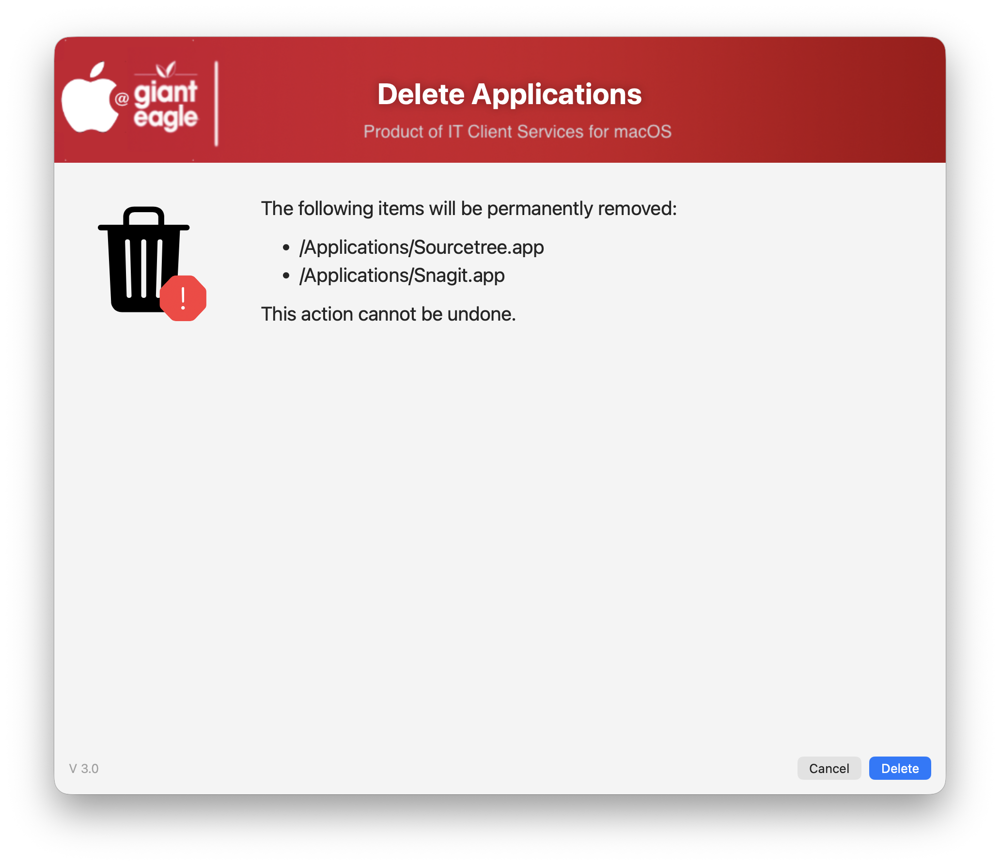

# App Delete

This script is designed to allow non-admin users the ability to remove applications and folders from the /Applications folder. 

You can control what applications they are not allowed to remove by putting items into the ```MANAGED_APPS``` array.  

You can also include folders that are allowed to be deleted, by putting them into the ```ALLOWED_FOLDERS``` array.

It automatically excludes the preinstalled items that come with the OS _[SIP Protected]_.

## AppDelete v3.0

AppDelete 3.0 is a major update focused on safer application removal, improved SwiftDialog handling, and support for applications installed in multiple locations.

### What's New

- Added support for multiple application search locations through the configurable `APPLICATION_SEARCH_PATHS` array.
- Added exact-path tracking for discovered applications and approved folders, ensuring selections remain tied to their validated filesystem locations.
- Rebuilt the SwiftDialog selection workflow using valid JSON generated and parsed with `jq`.
- Added duplicate-name detection when the same application is discovered in multiple search locations.
- Added a **Run Again** workflow after deletion, allowing additional applications to be removed without restarting AppDelete.

### Safety Improvements

- Added exact-name validation before deletion.
- Added protected-application revalidation before paths are approved for removal.
- Added symbolic-link protection during discovery, validation, and deletion.
- Added path-boundary validation to ensure deletion targets remain within configured application search locations.
- Added protection against accidentally deleting an application search directory itself.
- Added post-deletion verification instead of relying solely on the return code from `rm`.

### Reliability Improvements

- Added secure temporary-file creation using `mktemp` with automatic cleanup.
- Improved handling of SwiftDialog cancellation, empty selections, malformed output, and dialog errors.
- Improved prerequisite validation for SwiftDialog, `jq`, Jamf policies, and required support files.
- Improved error propagation and logging throughout the workflow.
- Application discovery is refreshed when **Run Again** is selected, preventing stale selections or paths from being reused.

### Multiple Application Locations

AppDelete can now search multiple locations for applications and approved application folders.

Search locations are configured using the `APPLICATION_SEARCH_PATHS` array:

```
APPLICATION_SEARCH_PATHS=(
    "/Applications"
    "${USER_DIR}/Applications"
)
```

### Screenshots ###
Picture of what the end users see when they run it:


The script will have them confirm their choices before the actual deletion occurs



and give them an option to do it again (and again)


| **Version**|**Notes**|
|:--------:|-----|
| 1.0 |  Initial Release |
| 1.1 |  Major code cleanup & documentation |
||		Structured code to be more inline / consistent across all apps |
| 1.2 |  Remove the MAC_HADWARE_CLASS item as it was misspelled and not used anymore... |
| 2.0 |  Bumped Swift Dialog min version to 2.5.0 |
||		NEW: Added option to allow folders to be deleted (ALLOWED_FOLDERS) |
||		Put shadows in the banner text |
|| 		Reordered sections to better show what can be modified |
| 2.1 |  Added option to sort array (case insensitive) after the application scan & folders added  |
| 2.2 |  Code cleanup |
||       Added feature to read in defaults file |
||        removed unnecessary variables. |
||        Fixed typos |
| 2.3 |  Add logic in the delete_files section to not continue processing if name is blank |
|| Fixed issue with reading in the defaults file and setting the variables. |
| 2.4 | Changed JAMF 'policy -trigger' to 'JAMF policy -event'
||       Optimized "Common" section for better performance
||       Fixed variable names in the defaults file section
| 2.5 | Updated SD Version requirements to 3.1.0
||       Added ability to set subtitle, color, and padding from defaults file
| 3.0 | Rebuilt selection handling using valid JSON and jq
||       Added support for multiple application search locations
||       Added exact-path tracking for discovered applications and approved folders
||       Added exact-name validation before deletion
||       Added protected-application revalidation
||       Added symlink and path-boundary protection
||       Added verified deletion results
||       Added secure temporary-file creation and cleanup
||       Added explicit handling for empty selections and dialog errors
||       Improved prerequisite and error propagation
