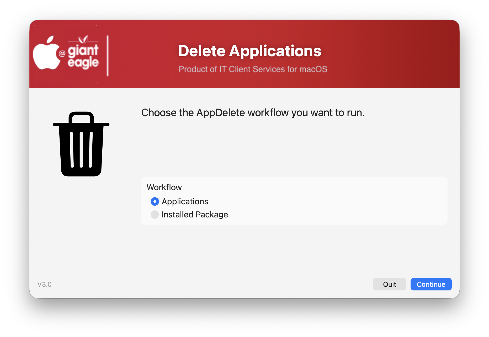
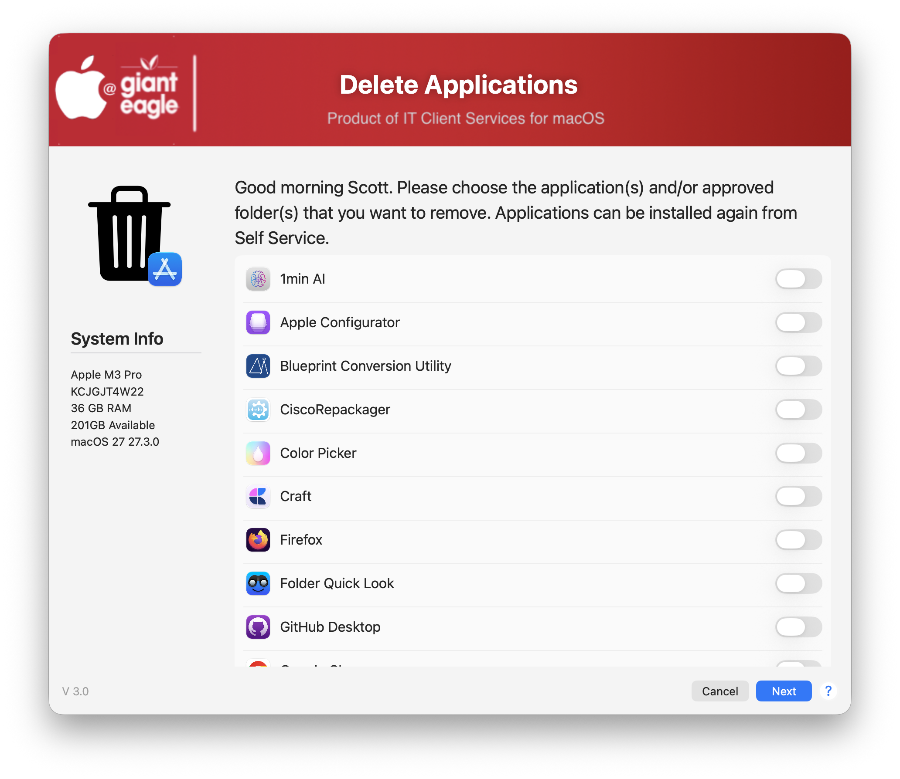
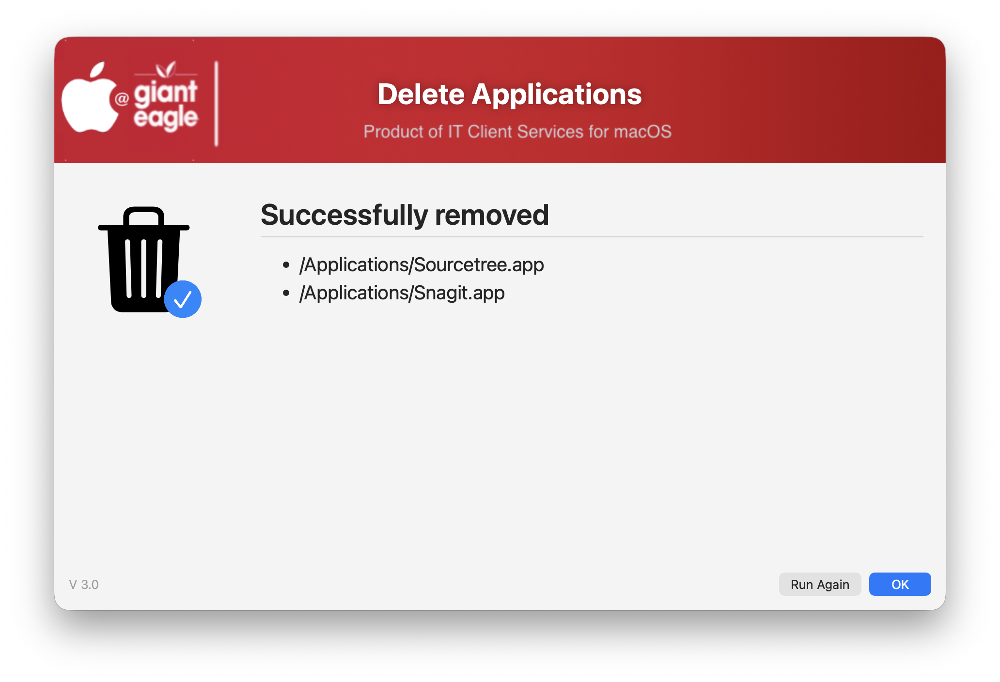
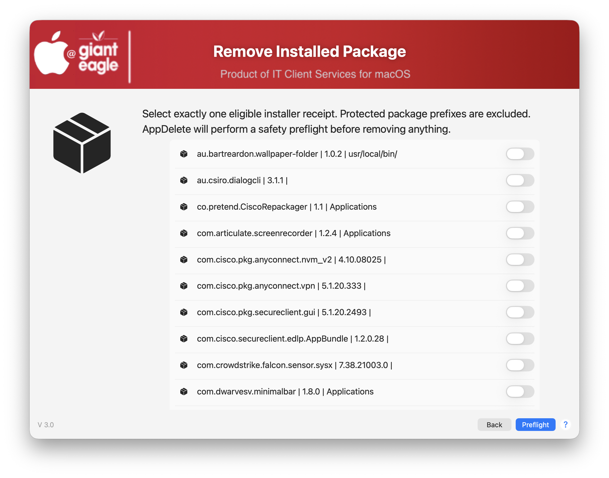
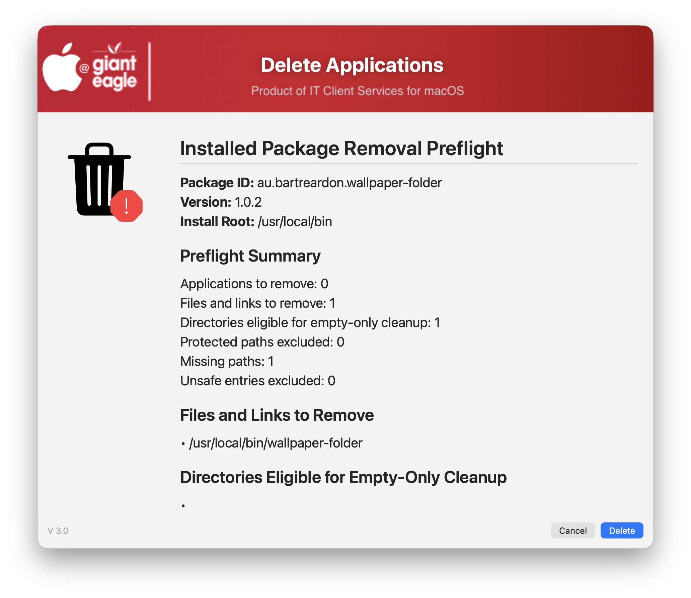

# AppDelete

AppDelete is a macOS utility that uses SwiftDialog to let standard users safely remove approved applications and folders without granting local administrator rights.

Version 3.0 significantly expands the original application-removal workflow. It adds stronger path validation, support for multiple application locations, administrator-controlled package receipt removal, audit manifests, protected package prefixes, and a more reliable SwiftDialog experience.

> [!CAUTION]
> The installed-package workflow is intended for administrators only. Package receipts are not vendor-supported uninstallers, and `pkgutil --forget` does not remove installed files by itself. Test package removal in a disposable virtual machine before using it in production.

## Requirements

- macOS
- Root execution, typically through Jamf Pro
- SwiftDialog 3.1.0 or later
- `jq`
- Jamf Pro for the optional dependency-install policy events used by the script

## AppDelete 3.0 highlights

### Application and folder removal

- Searches multiple application locations through `APPLICATION_SEARCH_PATHS`.
- Supports approved folders through `ALLOWED_FOLDERS`.
- Excludes protected applications configured in `NOT_ALLOWED_APPS`.
- Tracks every displayed item back to its exact validated filesystem path.
- Rejects symbolic links, unapproved selections, missing paths, search roots, and paths outside configured application locations.
- Verifies that each selected item is actually gone after removal.
- Refreshes discovery when **Run Again** is selected.

### Installed-package removal

Version 3.0 adds an administrator-focused workflow for removing content recorded by a macOS installer receipt.

The package workflow:

1. Lists eligible receipts returned by `pkgutil --pkgs`.
2. Excludes receipts matching `PROTECTED_PACKAGE_PREFIXES`.
3. Reads the selected receipt's metadata and installed paths.
4. Resolves and classifies only the selected receipt's content.
5. Excludes protected, unsafe, missing, and symlink-traversed paths.
6. Shows a preflight summary of what AppDelete intends to remove.
7. Removes approved files and links using exact paths.
8. Removes ordinary directories only when they are empty.
9. Removes validated application bundles beneath approved application search locations.
10. Forgets the receipt only after approved removal operations succeed.
11. Writes a JSON audit manifest containing the preflight and result details.

If all recorded package content is already absent, AppDelete can identify the receipt as stale and offer to forget only the receipt. No files are deleted in that case.

### Safety improvements

- Exact-name and exact-path validation
- Protected-application revalidation immediately before deletion
- Protected package-prefix checks during discovery, selection, preflight, and receipt forgetting
- Symbolic-link and ancestor-symlink protection
- Search-path boundary enforcement
- Protection against deleting an application search root
- Protected system path exclusions for receipt removal
- Conservative empty-directory cleanup with `rmdir`
- Verified deletion results
- Secure temporary files and cleanup traps
- JSON audit manifests for package operations

### Reliability and interface improvements

- SwiftDialog configuration is generated and parsed as valid JSON with `jq`.
- Dialog cancellation, empty selections, invalid output, and unexpected return codes are handled explicitly.
- Buttons are right-aligned and the script version is displayed in the SwiftDialog footer.
- Both workflows support **Run Again**.
- Application and package functions are organized into separate workflow sections for easier maintenance and debugging.

## Workflow selection

Jamf Pro reserves parameters 1 through 3. AppDelete uses **Parameter 4** to control the available workflow.

| Parameter 4 | Behavior |
|---|---|
| `applications` | Runs only the application and approved-folder workflow. This is the default and recommended end-user setting. |
| `receipts` | Runs only the installed-package receipt workflow. Scope this policy to administrators. |
| `choose` | Displays the Applications / Installed Package workflow selector. Scope this policy to administrators. |

Accepted aliases include `app`, `apps`, `application`, `package`, `packages`, `receipt`, `select`, and `prompt`.

An empty or unrecognized value safely defaults to the Applications workflow.

### Recommended Jamf Pro policies

Use separate policies that call the same script:

#### AppDelete

```text
Parameter 4: applications
```

Scope this policy to the users or Macs allowed to remove approved applications.

#### AppDelete - Package Removal

```text
Parameter 4: receipts
```

Scope this policy only to endpoint/Jamf administrators. Do not expose the package workflow to general Self Service users.

## Configuration

### Application search locations

Configure the directories AppDelete searches for removable applications and approved folders:

```zsh
APPLICATION_SEARCH_PATHS=(
    "/Applications"
    "${USER_DIR}/Applications"
)
```

Deletion targets must remain beneath one of these configured roots.

### Protected applications

Applications in this list are omitted from discovery and revalidated before removal:

```zsh
NOT_ALLOWED_APPS=(
    "Company Portal"
    "Falcon"
    "Jamf Connect"
    "Self Service"
    "Self Service+"
    "ZScaler"
)
```

Enter the application name without the `.app` extension.

### Approved folders

AppDelete can remove specifically approved folders beneath an application search location:

```zsh
ALLOWED_FOLDERS=(
    "Zscaler Copy"
    "Utilities copy"
    "Cisco copy"
)
```

Use folder names only, not full paths.

### Protected package prefixes

Package identifiers matching these exact prefixes are hidden from the receipt selector and rejected again before preflight and `pkgutil --forget`:

```zsh
PROTECTED_PACKAGE_PREFIXES=(
    "com.apple"
    "com.jamf"
)
```

For example, `com.jamf` protects both `com.jamf` and identifiers beginning with `com.jamf.`.

Add security, management, VPN, or compliance products that must never be removed in your environment.

### Protected receipt paths

`RECEIPT_PROTECTED_PREFIXES` and `RECEIPT_PROTECTED_EXACT_PATHS` prevent package receipts from authorizing removal of sensitive system and user locations.

Review these arrays carefully before enabling the package workflow. Avoid weakening the defaults unless you fully understand the affected receipt contents.

### Receipt preview limit

The package preflight screen displays a limited number of files and directories to keep SwiftDialog responsive:

```zsh
RECEIPT_PREVIEW_LIMIT=100
```

The complete inventory is retained in the JSON audit manifest.

### Defaults and support files

Before publishing or deploying AppDelete, customize:

- `DEFAULTS_DIR`
- `SUPPORT_DIR`
- `SD_BANNER_IMAGE`
- `SUPPORT_FILE_INSTALL_POLICY`
- `DIALOG_INSTALL_POLICY`
- `JQ_FILE_INSTALL_POLICY`

The Jamf policy event names must match policies in your own Jamf Pro environment.

## Package removal behavior

### Files and symbolic links

AppDelete removes only the exact approved paths identified during preflight. A symbolic link is removed as a link; its destination is not followed.

### Directories

Ordinary receipt directories are processed with `rmdir`, not recursive deletion. A directory remains when it contains untracked, shared, user-created, or application-created content.

### Application bundles

Receipt content inside a validated top-level `.app` beneath `APPLICATION_SEARCH_PATHS` may be promoted to a single application-bundle removal target. AppDelete revalidates the bundle immediately before recursive removal and refuses protected applications or symbolic links.

### Receipt forgetting

AppDelete calls:

```zsh
/usr/sbin/pkgutil --forget "$SELECTED_RECEIPT_ID"
```

only after the approved removal phase succeeds. It then verifies that the receipt is no longer registered.

### Audit manifest

Each package operation writes a permission-restricted JSON manifest next to the AppDelete log. The manifest records:

- Package ID and version
- Install root
- Approved applications, files, and directories
- Protected, missing, shared, and unsafe paths
- Removed and failed paths
- Whether the receipt was forgotten

The manifest is an audit record, not a backup or rollback mechanism.

## Screenshots

### Application Workflow

Picture of what the end users see when they run it:

Workflow choice (if PROMPT choosen)



Application Picker



The script will have them confirm their choices before the actual deletion occurs


and give them an option to do it again (and again)



### Package workflow

Installed Packages Picker



and the details of the pacakage that is about to be removed



## Testing recommendations

Before production deployment:

1. Run `/bin/zsh -n AppDelete.sh`.
2. Test the Applications workflow with protected apps, duplicate names, approved folders, symbolic links, and both configured search locations.
3. Test Parameter 4 with `applications`, `receipts`, `choose`, an empty value, and an invalid value.
4. Test package removal only in a disposable VM or test Mac.
5. Review the preflight screen and generated JSON manifest before confirming removal.
6. Confirm protected package prefixes never appear in the package selector.
7. Confirm stale receipts can be forgotten without deleting files.
8. Confirm **Run Again** works after successful, failed, and stale-receipt operations.

## Version history

| **Version**|**Notes**|
|:--------:|-----|
| 1.0 |  Initial Release |
| 1.1 |  Major code cleanup & documentation |
||		Structured code to be more inline / consistent across all apps |
| 1.2 |  Remove the MAC_HADWARE_CLASS item as it was misspelled and not used anymore... |
| 2.0 |  Bumped Swift Dialog min version to 2.5.0 |
||		NEW: Added option to allow folders to be deleted (ALLOWED_FOLDERS) |
||		Put shadows in the banner text |
|| 		Reordered sections to better show what can be modified |
| 2.1 |  Added option to sort array (case insensitive) after the application scan & folders added  |
| 2.2 |  Code cleanup |
||       Added feature to read in defaults file |
||        removed unnecessary variables. |
||        Fixed typos |
| 2.3 |  Add logic in the delete_files section to not continue processing if name is blank |
|| Fixed issue with reading in the defaults file and setting the variables. |
| 2.4 | Changed JAMF 'policy -trigger' to 'JAMF policy -event'
||       Optimized "Common" section for better performance
||       Fixed variable names in the defaults file section
| 2.5 | Updated SD Version requirements to 3.1.0
||       Added ability to set subtitle, color, and padding from defaults file
| 3.0 | Rebuilt selection handling using valid JSON and jq
||       Added support for multiple application search locations
||       Added exact-path tracking for discovered applications and approved folders
||       Added exact-name validation before deletion
||       Added protected-application revalidation
||       Added symlink and path-boundary protection
||       Added verified deletion results
||       Added secure temporary-file creation and cleanup
||       Added explicit handling for empty selections and dialog errors
||       Improved prerequisite and error propagation
||       Added a conservative installed-package receipt removal workflow
||       Excludes Apple receipts, user data, protected system locations, shared paths, and unsafe entries
||       Removes exact files and symlinks before empty-directory cleanup
||       Forgets the receipt only after all approved removals succeed
||       Writes a JSON removal manifest to the AppDelete log directory
||       Promoted receipt-owned application bundles under approved application roots
||       Collapses internal bundle files into one validated .app removal target
||       Adds application bundles to the preflight preview and JSON manifest
||       Added protected package-prefix support for package receipt removal
||       com.apple and com.jamf receipts are hidden and revalidated before preflight/forget
