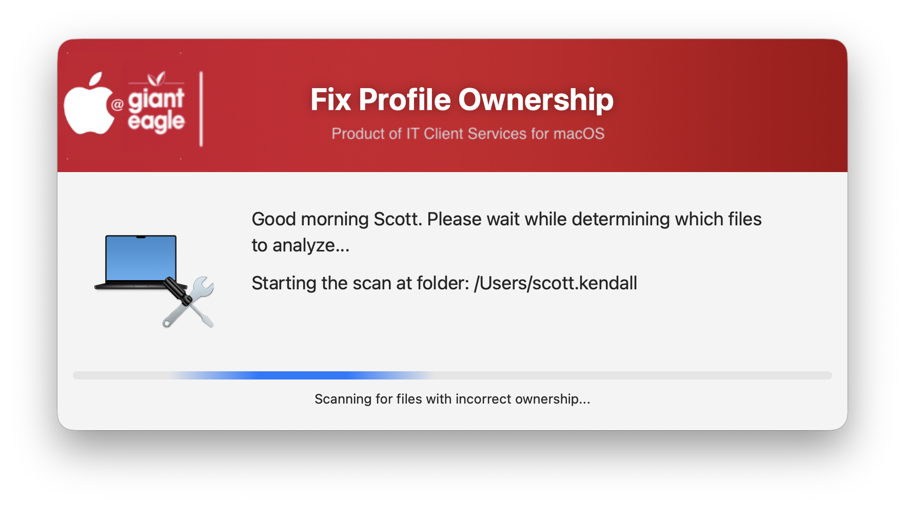
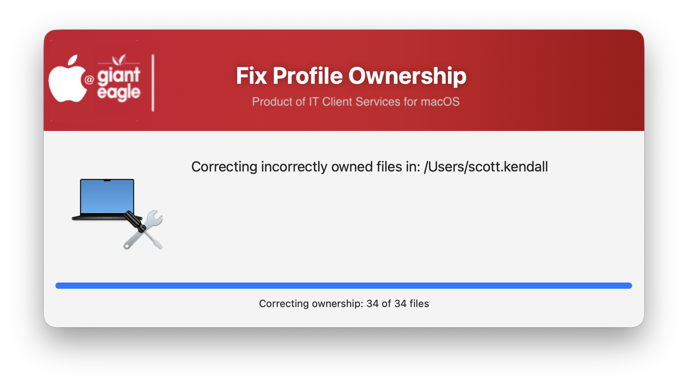

### Fix Profile Ownership

FixProfileOwner is designed to correct file ownership issues within the logged-in user's home directory. These issues can prevent users from saving, modifying, or deleting files that should belong to them.

Rather than changing ownership on every file in the user's home directory, FixProfileOwner scans for regular files that are not currently owned by the logged-in user and processes only those files. Files with correct ownership are left unchanged.

The ownership workflow:

- Validates the logged-in user and home directory before scanning.
- Scans the user profile once for incorrectly owned regular files.
- Stores the results in a null-delimited manifest for safe filename handling.
- Processes only files whose ownership requires correction.
- Revalidates each file before changing its ownership.
- Tracks corrected, skipped, and failed files.
- Returns a nonzero exit status if ownership corrections fail.

This targeted approach can significantly reduce processing time on large user profiles when only a small number of files have incorrect ownership.

The starting scan location is controlled by:

`USER_SCAN_START_DIR`

By default, this is set to the logged-in user's home directory.

Initial Scan

Progress during repair

| **Version**|**Notes**|
|:--------:|-----|
| 1.0 | Initial
| 1.1 | Code cleanup to be more consistent with all apps
| 1.2 | Changed logic in get_total_app_count function to use find | wc (much faster)
| 1.3 | Remove the MAC_HADWARE_CLASS item as it was misspelled and not used anymore...
| 1.4 | Code cleanup
|| Added feature to read in defaults file
||       removed unnecessary variables.
||       Bumped min version of SD to 2.5.0
||       Fixed typos
| 1.5 | Had to fix some dialog logic for Tahoe & SD v3.0
| 1.6 | Changed JAMF 'policy -trigger' to 'JAMF policy -event'
||       Optimized "Common" section for better performance
||       Fixed variable names in the defaults file section
| 2.0 | Updated minimum Swift Dialog version requirement to 3.1.0
||       Added configurable banner subtitle, text color, and padding
||      Added validation for the logged-in user and home directory
||      Changed the scan to identify only incorrectly owned regular files
||      Added a null-delimited ownership manifest for filename safety
||      Changed the ownership workflow to scan the user profile only once
||      Added file revalidation before changing ownership
||      Added corrected, skipped, and failed file totals
||      Added failure handling and nonzero exit results
||      Updated Swift Dialog command-file handling
