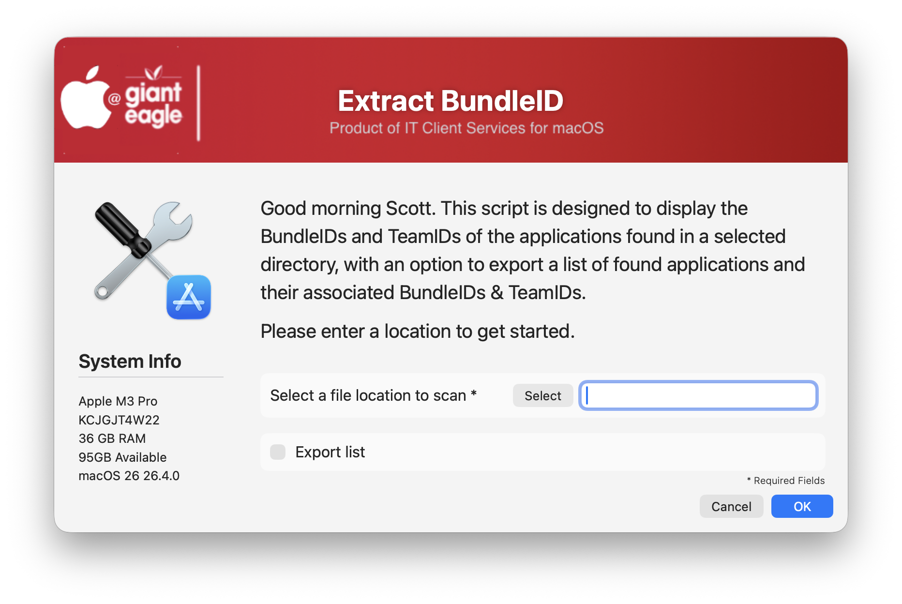
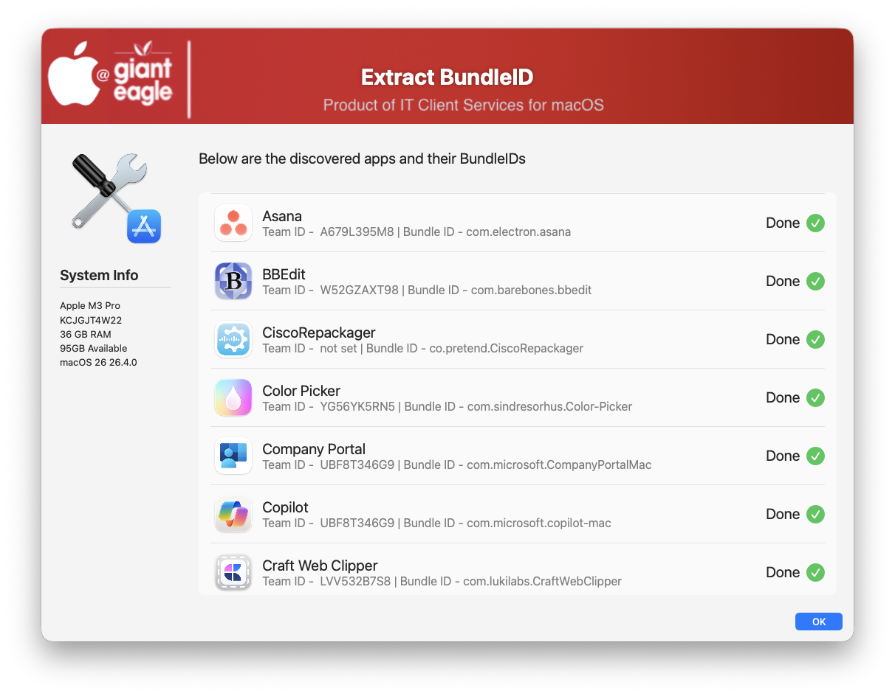

## GetBundleIDs  

Handy little utility to retreive all of the bundle IDs & Team IDs from a given directory.  If you need to only do one app, I have also included an Automator droplet to extract the Bundle ID from a single app.  I like to use this app when I am setting up manaaged login items in JAMF.  It needs both the Bundle ID and the Team ID.

Welcome Screen

Results screen

\| **Version**|**Notes**|
|:--------:|-----|
| 1.0 | Initial
| 1.1 | Code cleanup
||      Added feature to read in defaults file
||      removed unnecessary variables.
||       Fixed typos
| 1.2 | Fixed window layout for Tahoe & SD v3.0
| 1.3 | Changed JAMF 'policy -trigger' to 'JAMF policy -event'
||       Optimized "Common" section for better performance
||       Fixed variable names in the defaults file section
| 2.0 | Now includes TeamID in the listing as well
|| Changed the order of the items in the welcome screen
| 2.1 | Updated SD Version requirements to 3.1.0
||       Added ability to set subtitle, color, and padding from defaults file
| 2.2 | Improved application discovery and support for application paths containing spaces
||       Improved Bundle ID and Team ID retrieval with handling for missing values
||       Updated SwiftDialog list-item construction to use jq for safer JSON generation
||       Added error handling and return-code validation throughout the application workflow
||       Added notification when no applications are found in the selected directory
||       Enhanced exported results to include application name, path, Bundle ID, and Team ID
||       Improved SwiftDialog process management, command updates, and error handling
||       Improved temporary file handling and cleanup
||       General code cleanup and reliability improvements

