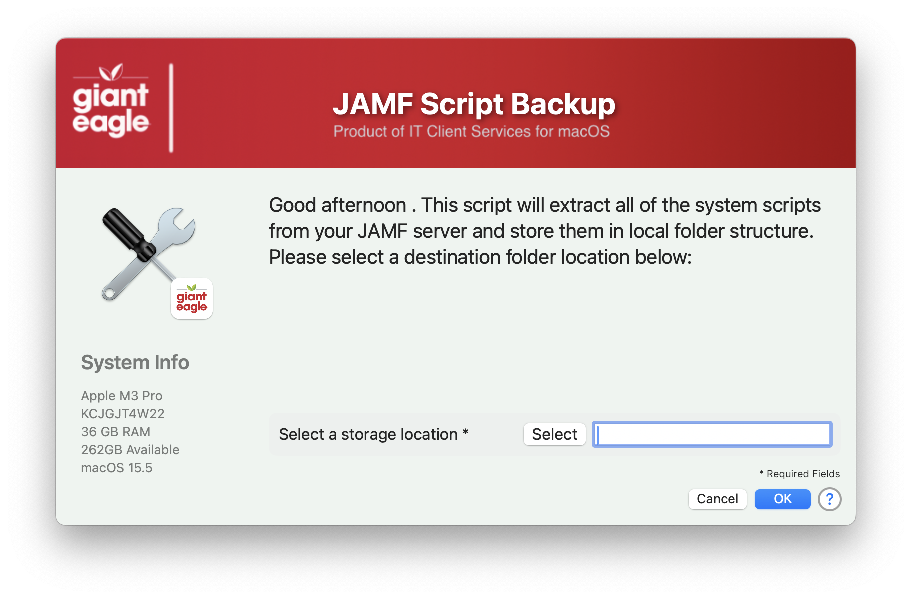
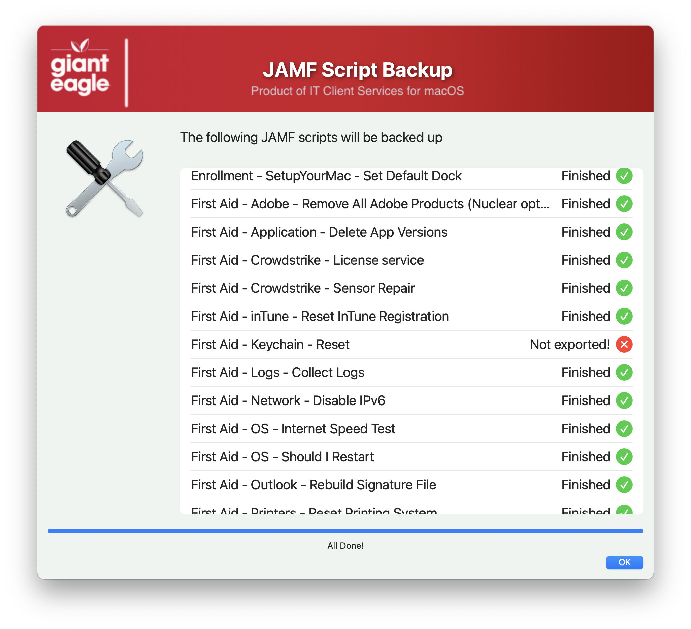
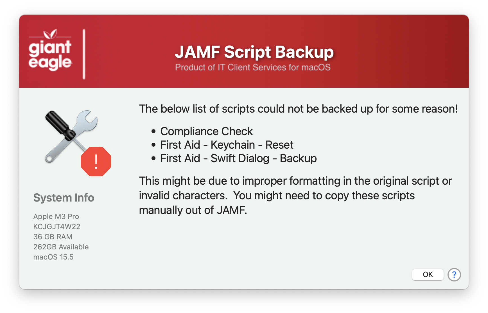

## Backup of JAMF system scripts

This script is designed to extract all of the system scripts from your JAMF server.  Why do you want to do this?

1.  Make a backup of your scripts in case your existing backup files is missing/corrupted (or you don't have one!)
2.  You inhereited a JAMF server from another person, and this can do a "brain dump" so you can review the scripts.
3.  Why not?  It is another example of what you can do with API scripts..

Welcome Screen



Process Screen



Errors window



At some point, I might combine both this script and my [BackupSSscripts](https://github.com/ScottEKendall/JAMF-Pro-Scripts/tree/main/BackupSSIcons) into one and make a "common" JAMF utility..just wanted to get this out now...

## JAMF API Information ##

If you are using the Modern JAMF API credentials, you need to set:

```Read Scripts```

## History ##

| **Version**|**Notes**|
|:--------:|-----|
| 1.0 | Initial
| 1.1 | Created a few new functions to reduce complexity / document function details / renamed all JAMF functions to start with JAMF......
| 1.2 | Add function to check for valid JAMF credentials
||       Fixed function to check which SS/SS+ is being used
||       Reworked top section for better idea of what can be modified
||       Bumped SwiftDialog min version to 2.5.0
| 1.3 | Changed JAMF 'policy -trigger' to JAMF 'policy -event'
||       Optimized "Common" section for better performance
||       Fixed variable names in the defaults file section
||       Fixed function to check which SS/SS+ is being used (again)
||       Had to increase window height for Tahoe & SD v3.0
| 2.0 | Updated SD Version requirements to 3.1.0
||       Added ability to set subtitle, color, and padding from defaults file
| 2.1 | Added category-based script backup folders
||       Added APFS-safe formatting for category and script filenames
||       Added an Uncategorized fallback for missing Jamf categories
||       Added Jamf script IDs to exported filenames to prevent collisions
||       Added destination-folder creation and write validation
||       Added detection and cleanup of empty or failed script exports
||       Added successful and failed backup counters
||       Added JSON backup manifest containing script metadata and totals
||       Added automatic token validation during long-running exports
||       Added current-script and total-script progress reporting
||       Added JSON structure validation for the script summary response
||       Improved failure reporting in SwiftDialog and the script log
