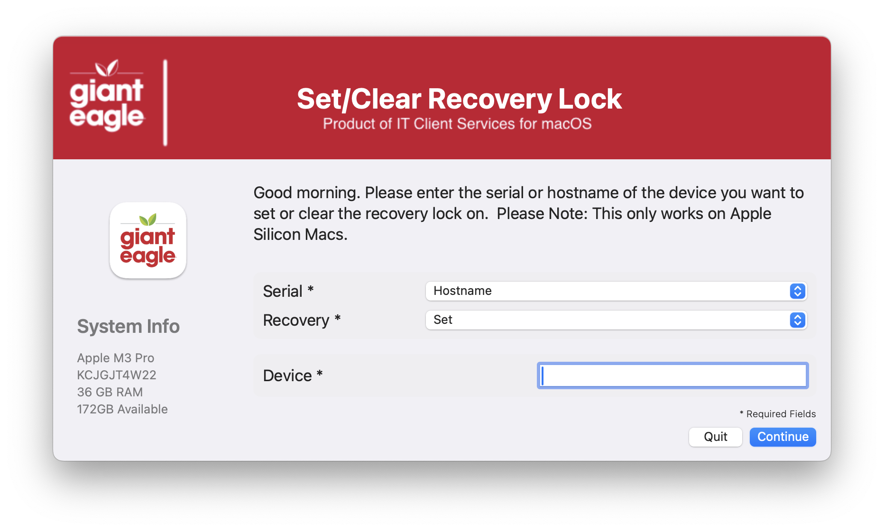
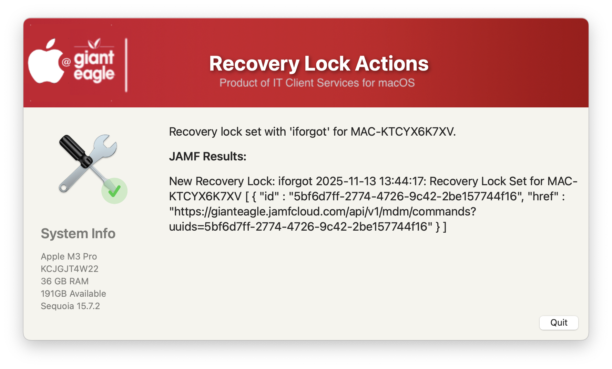
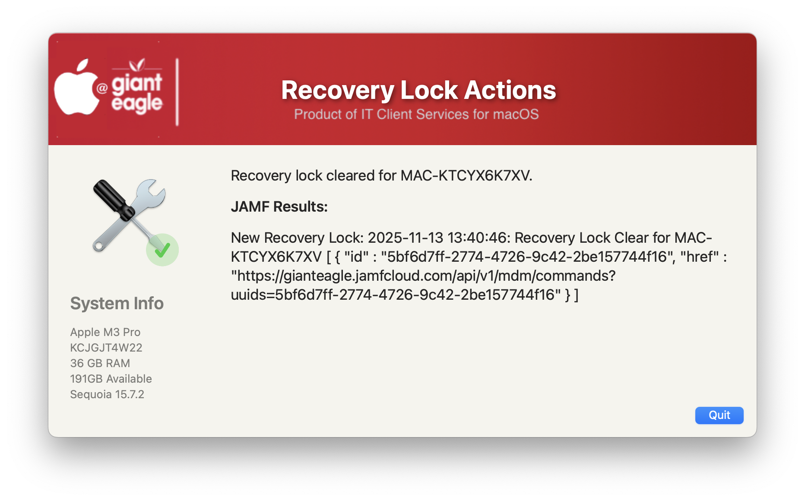
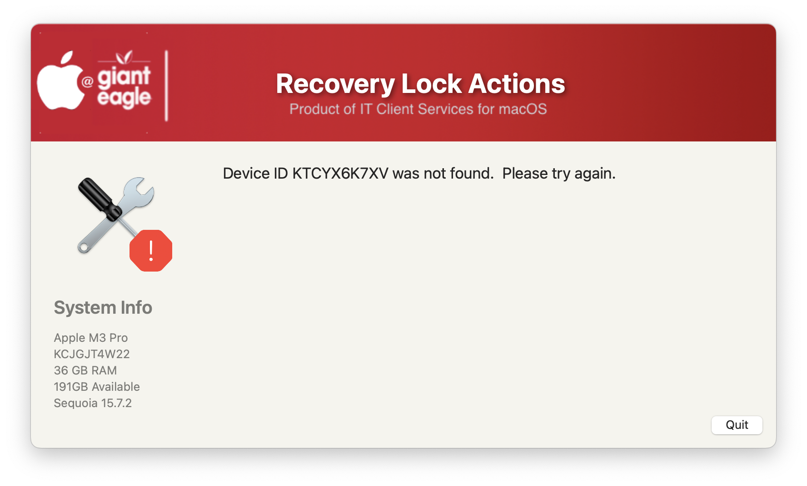
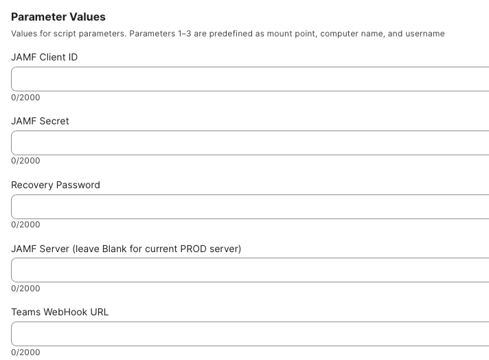

# JAMF Recovery Lock

JAMFRecoveryLock provides a SwiftDialog-based interface for viewing, setting, or clearing the Recovery Lock password on managed Apple Silicon Macs.

The utility allows a Jamf administrator to search for a computer by hostname or serial number, select the desired Recovery Lock action, and perform the operation through the Jamf Pro API.

JAMFRecoveryLock supports:

- View the Recovery Lock password stored in Jamf Pro
- Set a Recovery Lock password
- Clear a Recovery Lock password
- Search by hostname or serial number
- Jamf Pro OAuth Client Credentials authentication
- Jamf Pro username/password authentication
- SwiftDialog-based administrator interface
- Optional Microsoft Teams notifications through a Teams Workflow webhook

> **Note:** Recovery Lock is available only on supported Apple Silicon Macs.

### New in Version 2.2

Version 2.2 adds Microsoft Teams notification support and additional API and device lookup improvements.

✅ Microsoft Teams Workflow webhook integration  
✅ Adaptive Card notifications  
✅ Success and failure notifications  
✅ Optional HTTPS-hosted Adaptive Card icon  
✅ Device, operator, action, Jamf Pro server, and timestamp details  
✅ Recovery Lock passwords excluded from Teams notifications  
✅ Non-fatal Teams webhook failure handling  
✅ Improved device lookup failure reporting  
✅ Corrected Classic API authentication endpoint  

### Recovery Lock Actions

JAMFRecoveryLock supports three operations:

#### View

Retrieves the Recovery Lock password stored in Jamf Pro and displays it locally using SwiftDialog.

The Recovery Lock password is never included in a Microsoft Teams notification.

#### Set

Sets Recovery Lock using the password supplied through Jamf Pro script parameter 6.

The configured Recovery Lock password is never included in a Microsoft Teams notification.

#### Clear

Submits the command necessary to clear Recovery Lock from the selected Mac.

### Screenshots

Initial Welcome screen

Successful lock for device.

Successful clear for device

Error screen for no device found

Details of JAMF Parameter(s)

### Jamf Pro API Requirements

If you are using the Jamf Pro API for authentication, the API account or API role requires the following privileges:

- Send Set Recovery Lock Command
- View MDM Command Information
- Read Computers
- View Recovery Lock

The script supports either OAuth Client Credentials or Jamf Pro username/password authentication.

### Jamf Pro Script Parameters

| Parameter | Purpose |
|---|---|
| 3 | Jamf logged-in username |
| 4 | Jamf Pro API username or OAuth Client ID |
| 5 | Jamf Pro API password or OAuth Client Secret |
| 6 | Recovery Lock password used when selecting Set |
| 7 | Jamf Pro server URL |
| 8 | Microsoft Teams Workflow webhook URL |

Parameter 6 is required only when using the **Set** action.

Parameter 8 is optional. If no Microsoft Teams Workflow webhook URL is supplied, Recovery Lock operations continue normally without sending a Teams notification.

### Microsoft Teams Webhook Notifications

Version 2.2 supports optional Microsoft Teams notifications using a Teams Workflow webhook.

This provides Jamf administrators with an operational notification when a Recovery Lock action succeeds or fails.

The Teams notification includes:

- Operation status
- Recovery Lock action
- Target device
- Administrator/operator
- Jamf Pro server
- Script name
- Date and time
- Result or failure information

Notifications are sent as Microsoft Teams Adaptive Cards for easier viewing in a Teams channel.

#### Sensitive Information

JAMFRecoveryLock intentionally excludes sensitive information from Teams notifications.

The Teams Adaptive Card does **not** include:

- Recovery Lock passwords retrieved from Jamf Pro
- The Recovery Lock password supplied through parameter 6
- Jamf Pro account passwords
- OAuth Client Secrets
- Jamf Pro API tokens
- Raw Jamf Pro API responses

When the **View** action successfully retrieves a Recovery Lock password, Teams is notified that the operation succeeded, but the password itself remains local to the SwiftDialog session.

### Creating the Teams Webhook

Microsoft Teams notifications use a Teams Workflow webhook.

1. Open the destination channel in Microsoft Teams.
2. Open **Workflows**.
3. Create a workflow using the webhook trigger.
4. Configure the workflow to post the received message to the desired Teams channel.
5. Configure the webhook trigger authentication appropriate for your environment.
6. Save the workflow and copy the generated webhook URL.
7. Add the webhook URL to Jamf Pro as script parameter 8.

> **Important:** Treat the webhook URL as sensitive information. Do not hard-code it into the script or publish it in a public GitHub repository.

#### Webhook URL Format

Copy the Microsoft Teams Workflow webhook URL exactly as generated by the workflow.

The URL should remain a single, complete URL.

Do not manually add escape characters such as `\` before `&`, `?`, `%`, or `=` characters.

For example:

    https://example.environment.api.powerplatform.com/powerautomate/automations/direct/workflows/WORKFLOW_ID/triggers/manual/paths/invoke?api-version=1&sp=%2Ftriggers%2Fmanual%2Frun&sv=1.0&sig=SIGNATURE

When testing the script manually from Terminal, place the entire webhook URL inside quotes:

    "https://example.environment.api.powerplatform.com/powerautomate/automations/direct/workflows/WORKFLOW_ID/triggers/manual/paths/invoke?api-version=1&sp=%2Ftriggers%2Fmanual%2Frun&sv=1.0&sig=SIGNATURE"

Do not change it to:

    ...?api-version=1\&sp=%2Ftriggers%2Fmanual%2Frun\&sv=1.0\&sig=SIGNATURE

Values such as `%2F` are URL-encoded characters supplied by Microsoft and should not be changed or decoded.

> **Important:** Treat the webhook URL as sensitive information because the generated URL contains authorization information. Do not publish an actual webhook URL in GitHub, logs, screenshots, or documentation.

#### Adaptive Card Icon

An optional HTTPS-hosted image can be displayed next to the Adaptive Card title.

Configure the image using:

    TEAMS_WEBHOOK_ICON_URL="https://example.com/path/to/icon.png"

The image must be accessible through HTTPS.

If no icon is specified, the Adaptive Card is sent normally without an image.

If the configured icon URL is invalid, JAMFRecoveryLock logs a warning and sends the Teams notification without the icon.

A small square PNG with a transparent background works well for Teams notifications.

#### Notification Behavior

Teams notification support is controlled in the script using:

    TEAMS_WEBHOOK_ENABLED="true"

To disable Microsoft Teams notifications:

    TEAMS_WEBHOOK_ENABLED="false"

Teams notifications are also automatically skipped when script parameter 8 is empty.

A Microsoft Teams webhook failure does not cause an otherwise successful Recovery Lock operation to fail.

The Jamf Pro Recovery Lock operation remains authoritative. Teams is used only for notification.

### Credits

Kudos to Karthikeyan Marappan for coming up with the original concept. I added the SwiftDialog GUI frontend and expanded the utility with current Jamf Pro API support, improved authentication and validation, and Microsoft Teams notifications.

Original source:

https://gist.github.com/karthikeyan-mac/185bf8319fa9560f300ed26553a7a54d

### History

| Version | Notes |
|---|---|
| 1.0 | Initial release |
| 1.1 | Removed the unused and misspelled `MAC_HADWARE_CLASS` item |
| 1.2 | Reworked the configuration section for improved readability |
|  | Renamed Jamf functions to begin with `JAMF_` |
| 1.3 | Verified compatibility with Jamf Pro 11.20 |
|  | Added Self Service / Self Service+ detection and icon handling |
|  | Added support for Client ID / Client Secret or username/password authentication |
|  | Improved variable organization |
|  | Updated SwiftDialog requirement to 2.5.0 |
| 1.4 | Fixed Jamf token invalidation function call |
|  | Improved Self Service / Self Service+ detection |
|  | Added Jamf credential validation |
|  | Renamed utility to `JAMFRecoveryLock.sh` |
| 1.5 | Added ability to view the Recovery Lock password |
|  | Added updated APIs for setting and clearing Recovery Lock |
|  | Added HTTP results after Set/Clear commands |
| 1.6 | Increased window height for macOS Tahoe and SwiftDialog 3.0 |
| 1.7 | Changed Jamf policy invocation to use `jamf policy -event` |
|  | Optimized common functions |
|  | Corrected defaults-file variable names |
| 2.0 | Updated SwiftDialog requirement to 3.1.0 |
|  | Added configurable subtitle, banner color, and padding |
| 2.1 | Verified compatibility with Jamf Pro 11.30 |
|  | Updated Recovery Lock workflows to current Jamf Pro API endpoints |
|  | Improved OAuth and Classic API token handling |
|  | Added automatic token renewal |
|  | Improved API connection and response validation |
|  | Improved unique computer lookup validation |
|  | Improved Recovery Lock password retrieval handling |
|  | Added Set Recovery Lock password validation |
|  | Improved temporary-file security and token cleanup |
|  | Improved logging and SwiftDialog error handling |
|  | General code cleanup and stability improvements |
| 2.2 | Added optional Microsoft Teams Workflow webhook notifications |
|  | Added Adaptive Card notifications for successful and failed Recovery Lock operations |
|  | Added optional HTTPS-hosted Adaptive Card icon |
|  | Excluded Recovery Lock passwords, credentials, API tokens, and raw API responses from Teams notifications |
|  | Added non-fatal Teams webhook error handling |
|  | Improved device lookup failure notifications |
|  | Corrected the Classic API authentication endpoint |
