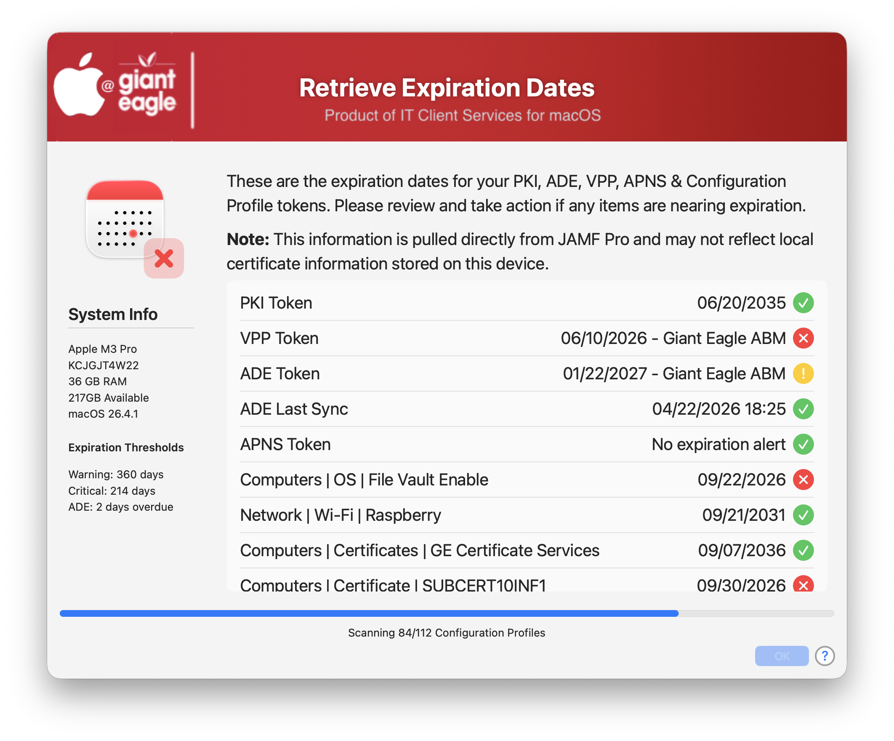
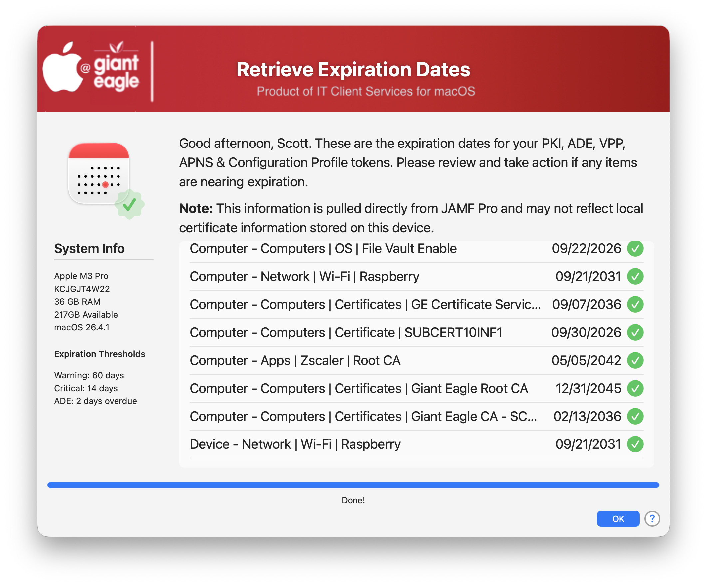
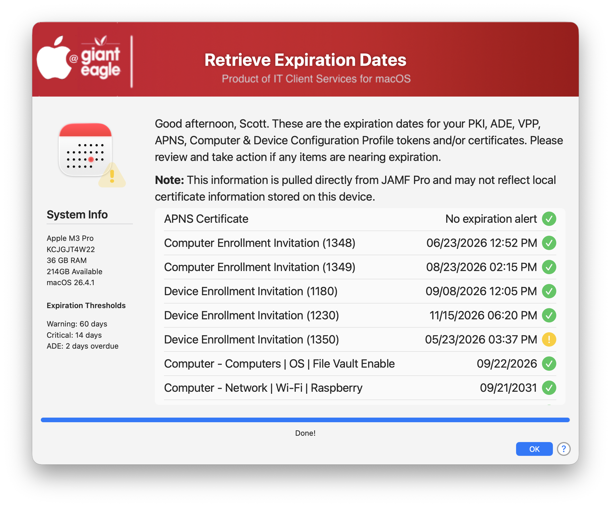

### JAMF Retrieve Expiration Dates

Jamf Pro has numerous service tokens, certificates, and enrollment assets that must be tracked and renewed. Finding all of these expiration dates normally requires navigating through multiple Jamf Pro settings, computer configuration profiles, and mobile device configuration profiles.

JAMFRetrieveExpireDates provides a centralized way to retrieve and monitor these expiration dates. It can be run interactively using SwiftDialog or silently as a scheduled Jamf Pro maintenance task.

Silent monitoring can optionally send Microsoft Teams notifications through a Teams Workflow webhook using Adaptive Cards, allowing Jamf administrators to receive warnings, critical expiration alerts, and operational errors without manually running the utility.

The utility can monitor:

- Volume Purchase Plan (VPP)
- Automated Device Enrollment (ADE)
- Jamf Pro PKI certificate
- Apple Push Notification Service (APNS)
- Computer configuration profile certificates
- Mobile device configuration profile certificates
- Computer enrollment invitations
- Mobile device enrollment invitations
- ADE last synchronization status

#### New in Version 2.1

Version 2.1 adds unattended monitoring and Microsoft Teams notification support.

- ✅ Silent execution for scheduled Jamf Pro maintenance workflows
- ✅ Microsoft Teams Workflow webhook integration
- ✅ Adaptive Card notifications
- ✅ Warning, critical, and operational error reporting
- ✅ Configuration profile certificate details in Teams notifications
- ✅ Configurable success, warning, and critical notifications
- ✅ Centralized monitoring-result collection
- ✅ Improved silent-mode and SwiftDialog handling
- ✅ Standardized Jamf Pro API requests using reusable curl arguments

----------

#### Monitoring Thresholds

Expiration and synchronization warning thresholds can be customized:

```zsh
THRESHOLD_DAYS_WARNING=60
THRESHOLD_DAYS_CRITICAL=14
ADE_SYNC_WARNING_THRESHOLD=2
```

With these defaults:

- Expirations within **60 days** generate a warning.
- Expirations within **14 days** generate a critical alert.
- ADE synchronization older than **2 days** generates a warning.

#### Jamf Pro API Requirements

If you are using the Jamf Pro API for authentication, the API account or API role requires the following privileges:

```
Read VPP Assignment
Read macOS Configuration Profiles
Read Push Certificates
Read iOS Configuration Profiles
Read Mobile Device Enrollment Invitations
Read VPP Invitations
Read PKI
Read Device Enrollment Program Instances
Read Computer Enrollment Invitations
Read Enrollment Profiles
Read Enrollment Customizations
Read Volume Purchasing Locations
View MDM command information in Jamf Pro API
```

If you know of additional expiration dates that can be retrieved from Jamf Pro, please let me know and I will be happy to investigate adding them.

### Jamf Pro Script Parameters

| Parameter | Purpose |
| --- | --- |
| 4 | Jamf Pro API username or OAuth Client ID |
| 5 | Jamf Pro API password or OAuth Client Secret |
| 6 | Jamf Pro server URL |
| 7 | Execution mode. Use `silent` for unattended operation |
| 8 | Microsoft Teams Workflow webhook URL |

Parameters 7 and 8 are optional unless silent monitoring or Microsoft Teams notifications are being used.

Silent mode can be enabled using script parameter 7:

```text
silent
```

When silent mode is enabled:

- SwiftDialog is not displayed.
- Expiration and health checks continue normally.
- Results are collected throughout the scan.
- A Microsoft Teams notification can optionally be sent when processing completes.

### Silent Monitoring

JAMFRetrieveExpireDates can run without displaying the SwiftDialog interface, making it suitable for scheduled Jamf Pro policies and periodic maintenance checks.

When silent mode is enabled, the script performs the same expiration and health checks without presenting the interactive user interface.


### Microsoft Teams Webhook Notifications 

Version 2.1 supports optional Microsoft Teams notifications using a Teams Workflow webhook. 

This allows the script to operate as an unattended monitoring utility and notify administrators when expiring certificates, tokens, synchronization issues, or operational errors are detected.

The Teams notification includes:

- Jamf Pro server
- Script name and version
- Critical item count
- Warning item count
- Operational error count
- Check date and time
- Details for affected certificates, tokens, profiles, or services

Notifications are sent as Microsoft Teams Adaptive Cards for easier viewing in a Teams channel.


### Creating the Teams Webhook

Microsoft Teams notifications use a Teams Workflow webhook.

1. Open the destination channel in Microsoft Teams.
2. Open **Workflows**.
3. Create a workflow using the webhook trigger.
4. Configure the workflow to post the received message to the desired Teams channel.
5. Configure the webhook trigger authentication appropriate for your environment.
6. Save the workflow and copy the generated webhook URL.
7. Add the webhook URL to Jamf Pro as script parameter 8.

> **Important:** Treat the webhook URL as sensitive information. Do not hard-code it into the script or publish it in a public GitHub repository.

##### Webhook URL Format

Copy the Microsoft Teams Workflow webhook URL exactly as generated by the workflow.

The URL should remain a single, complete URL. Do not manually add escape characters such as `\` before `&`, `?`, `%`, or `=` characters.

For example:

```text
https://example.environment.api.powerplatform.com/powerautomate/automations/direct/workflows/WORKFLOW_ID/triggers/manual/paths/invoke?api-version=1&sp=%2Ftriggers%2Fmanual%2Frun&sv=1.0&sig=SIGNATURE
```

When testing the script manually from Terminal, place the entire webhook URL inside quotes:

```zsh
"https://example.environment.api.powerplatform.com/powerautomate/automations/direct/workflows/WORKFLOW_ID/triggers/manual/paths/invoke?api-version=1&sp=%2Ftriggers%2Fmanual%2Frun&sv=1.0&sig=SIGNATURE"
```

Do **not** change it to:

```text
...?api-version=1\&sp=%2Ftriggers%2Fmanual%2Frun\&sv=1.0\&sig=SIGNATURE
```

Values such as `%2F` are URL-encoded characters supplied by Microsoft and should **not** be changed or decoded.

The URL itself is identical whether it is stored in Jamf Pro or supplied manually from Terminal. **Quotation marks belong to the shell command, not to the webhook URL.**

> **Important:** Treat the webhook URL as sensitive information because the generated URL contains authorization information. Do not publish an actual webhook URL in GitHub, logs, screenshots, or documentation.

#### Notification Settings

Teams notification behavior can be controlled using:

```zsh
TEAMS_NOTIFY_SUCCESS="true"
TEAMS_NOTIFY_WARNING="true"
TEAMS_NOTIFY_CRITICAL="true"
```

During initial testing, enabling all three notification types makes it easy to verify the Teams Workflow.

For routine scheduled monitoring, you may prefer:

```zsh
TEAMS_NOTIFY_SUCCESS="false"
TEAMS_NOTIFY_WARNING="true"
TEAMS_NOTIFY_CRITICAL="true"
```

This keeps the Teams channel focused on warnings, critical conditions, and operational failures instead of posting a message after every successful scan.

#### Scheduled Monitoring Example

To use JAMFRetrieveExpireDates as a scheduled Jamf Pro maintenance task:

```text
Parameter 4: API account / OAuth Client ID
Parameter 5: API password / OAuth Client Secret
Parameter 6: https://your-instance.jamfcloud.com
Parameter 7: silent
Parameter 8: Microsoft Teams Workflow webhook URL
```

The Jamf Pro policy can then be configured to run on a recurring schedule.

When running silently, the script performs all expiration and health checks, collects the results, optionally sends a single Teams Adaptive Card, and cleans up the Jamf Pro API token before exiting.


### Examples ###

Screen showing failed items



Screen show all passed



NEW in v1.3 - Screens of Computer & Mobile Device Enrollments



## History ##

| **Version**|**Notes**|
|:--------:|-----|
| 1.0 | Initial
| 1.1 | Minor wording change from APNS Token to APNS Certificate, Also added some additional verbiage to the welcome message to clarify tokens and/or certificates
| 1.2 | Removed extraneous "echo" statements that were used for testing and debugging purposes
||       Change APNS Sync date to show date & time in 12 hour format with AM/PM
||       Made window resizable and moveable to accommodate for longer lists of expiring items
||       Optimized the API calls to reduce the number of calls being made to the server and speed up the retrieval process
||       Fixed issue of the jamf_cli for devices calling the incorrect API endpoints
| 1.3 | Added check for Computer & Device Invitations and retrieval of their expiration dates
| 2.0 | Major "under the hood" production improvements
|| Added OAuth and Classic API authentication support
|| Added support for different JAMF instances (not just primary)
|| Added automatic token management and renewal
|| Added enrollment invitation expiration monitoring
|| Added centralized date parsing and expiration processing
|| Added comprehensive API validation and error handling
|| Added secure temporary-file management and cleanup
|| Enhanced configuration profile certificate scanning
|| Added operational health monitoring and threshold alerts
|| Improved SwiftDialog user experience and progress reporting
|| Expanded logging, diagnostics, and recovery handling
|| Significant security, reliability, and performance improvements
| 2.1 | Added silent monitoring and Microsoft Teams Workflow webhook notifications
||     Added Adaptive Card reporting for warning, critical, and operational errors
||     Added configurable success, warning, and critical notifications
||     Added centralized monitoring-result collection
||     Added configuration profile certificate details to Teams reporting
||     Refactored Jamf Pro API requests using centralized curl argument arrays for improved consistency and maintainability
||     Improved silent-mode handling and SwiftDialog command updates
