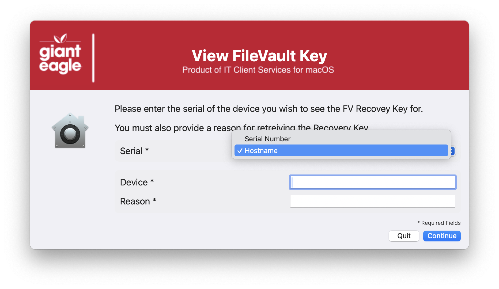
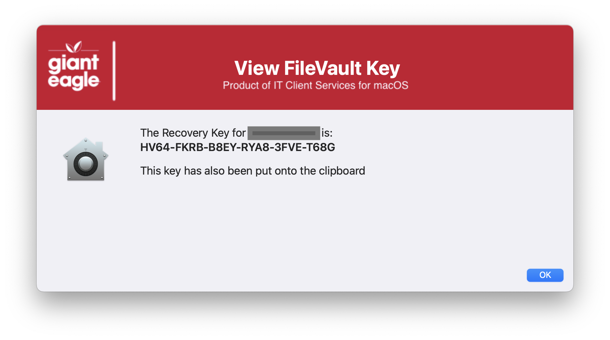

## Retrieve FileVault Password

Trying to create a series of scripts to assist the HelpDesk in doing some macOS Support.  I don't want to give them access the JAMF as it would be way to confusing for them.  They can find the system by either Serial # or by HostName, and they have to give a reason for the pull.





## JAMF API Information ##

If you are using the Modern JAMF API credentials, you need to set:

```Read Computer Security``` ```Read Computers``` ```View Disk Encryption Recovery Key```

| **Version**|**Notes**|
|:--------:|-----|
| 1.0 | Initial
| 1.1 | Major code cleanup & documentation / Structred code to be more inline / consistent across all apps_
| 2.0 | You can now use JAMF classic & modern credentials
||   Added feature to read in defaults file
||   Add verification of JAMF credentials and error trapping if ID doesn't have rights
||   Compatible with JAMF 11.21 and higher using the new APIs
| 2.1 | Had to increase window height for Tahoe & SD v3.0
| 2.2 | Changed JAMF 'policy -trigger' to 'JAMF policy -event'
||       Optimized "Common" section for better performance
||       Fixed variable names in the defaults file section
| 2.3 | Updated SD Version requirements to 3.1.0
||       Added ability to set subtitle, color, and padding from defaults file
| 2.4 | Production hardening and Jamf API reliability improvements
||       Support for multiple servers.
||       Added root validation and hardened log file/directory permissions
||       Improved SwiftDialog installation, version validation, and error handling
||       Improved support-file and jq installation/validation
||       Added centralized user-context initialization and cleanup/exit handling
||       Added reusable Jamf curl argument builder and Jamf date parser
||       Hardened Jamf Pro server and connectivity validation
||       Hardened Classic API and OAuth token retrieval and validation
||       Added token expiration tracking and automatic token renewal
||       Improved Jamf API token invalidation and cleanup
||       Reworked device lookup using Jamf Pro computer inventory API
||       Added handling for zero, single, and multiple device matches
||       Hardened FileVault recovery key retrieval and API error handling
||       Added secure temporary API response files with automatic cleanup
||       Improved SwiftDialog JSON validation and required-field handling
||       Added structured function return-code handling throughout main workflow
||       Improved clipboard failure detection and logging