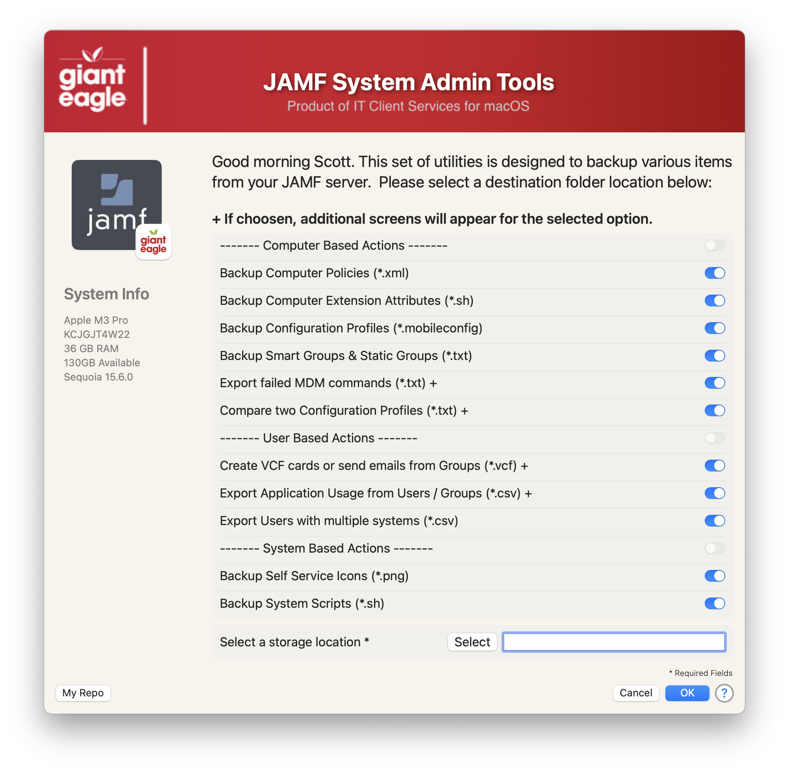
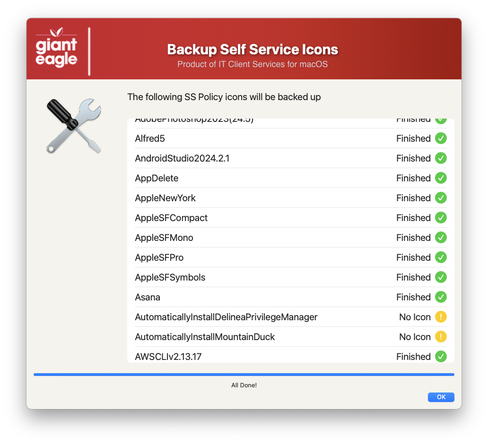
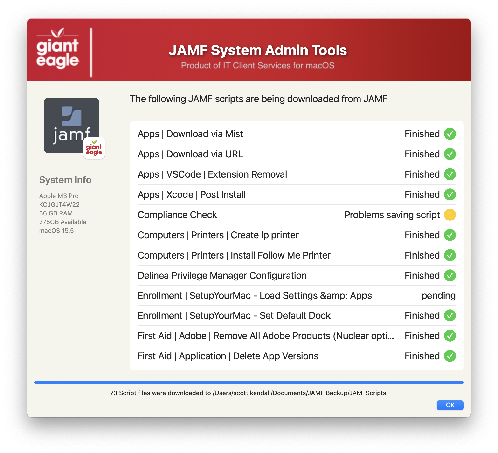
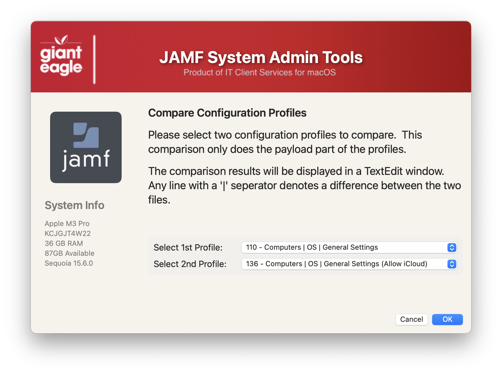
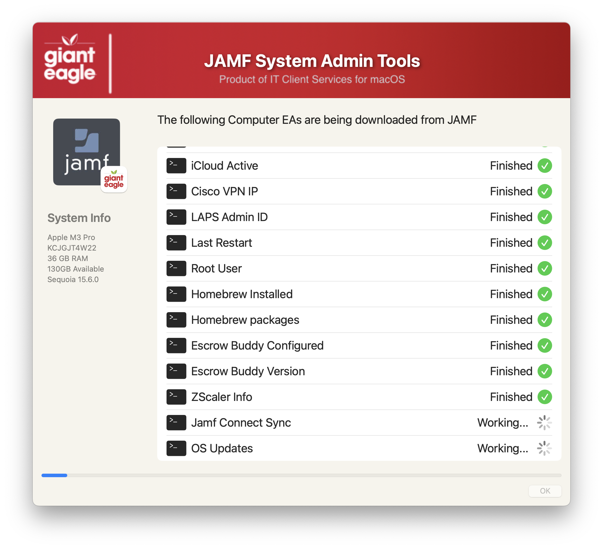
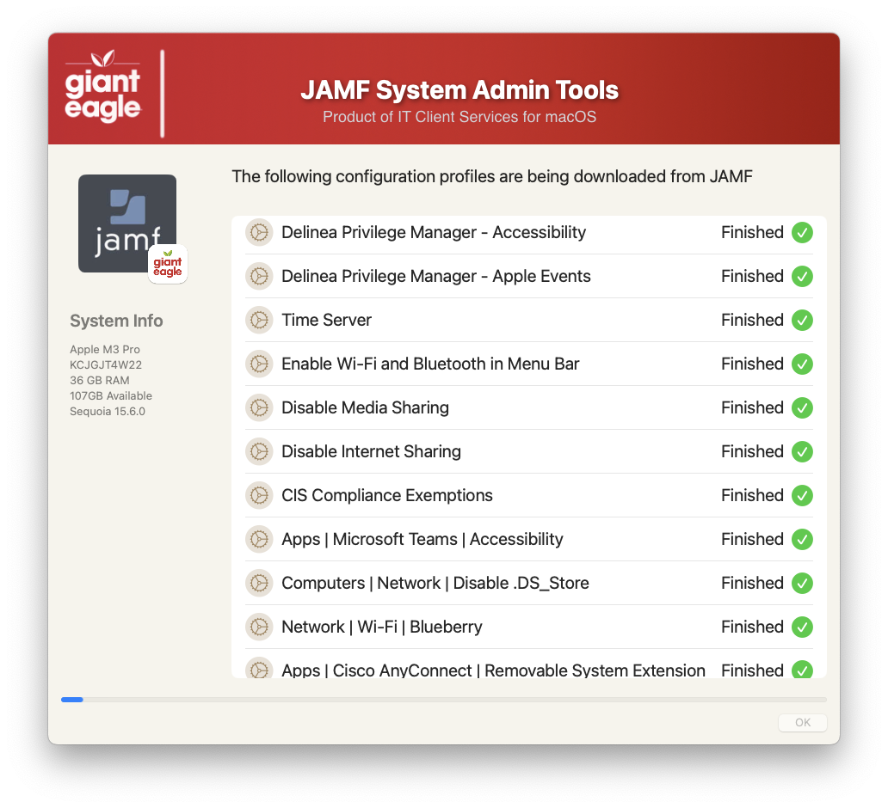
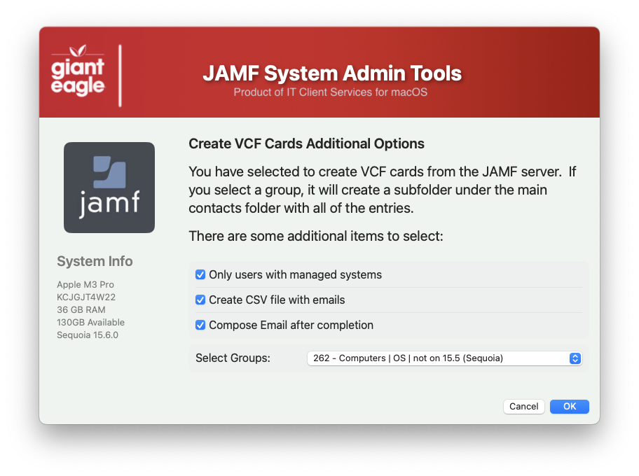
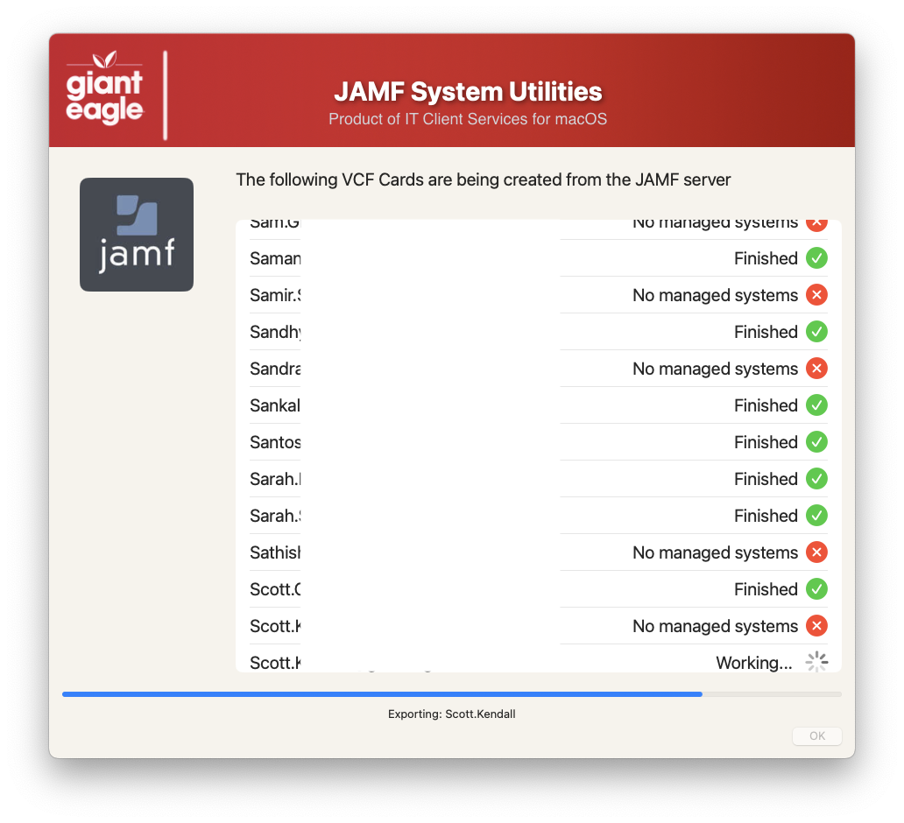
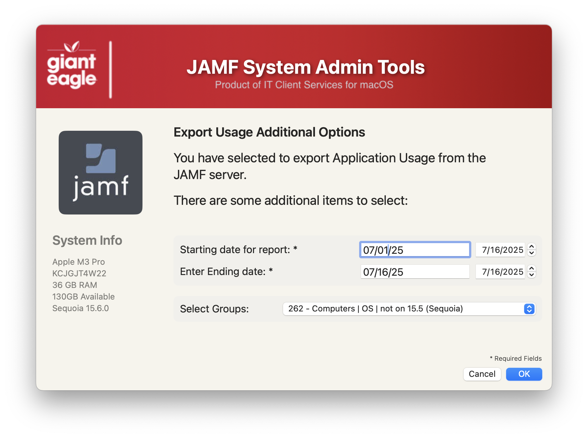
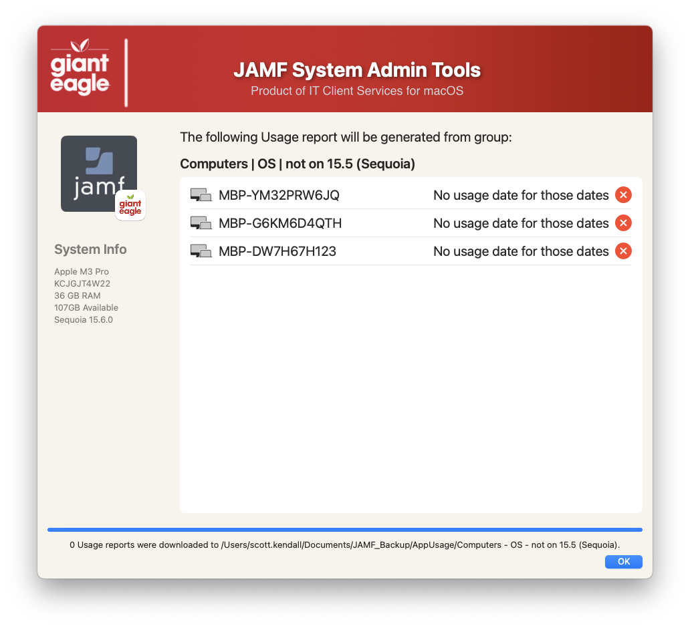

## JAMF System Utilities    

JAMF System Utilities is an interactive administration, backup, reporting, and troubleshooting utility for Jamf Pro.

The utility provides a SwiftDialog-based interface for exporting Jamf Pro configuration data, generating inventory and user reports, backing up Self Service resources, reviewing failed MDM commands, comparing configuration profiles, and performing other common Jamf administrative tasks.

Version 3.0 modernizes the underlying API workflows with JSON/jq processing, complete computer-inventory pagination, bounded parallel processing, improved authentication and token handling, and hardened API error handling.
  
Why do you want to do this?

1.  Make a backup of your scripts, configurations & icons in case your existing backup files is missing/corrupted (or you don't have one!)
2.  You inheritted a JAMF server from another person, and this can do a "brain dump" so you can review the settings.
3.  Why not?  It is another example of what you can do with API scripts..

## Available Operations

### Computer Operations

- **Backup Computer Policies** - Export computer policies.
- **Computer Extension Attributes** - Export computer Extension Attributes.
- **Configuration Profiles** - Export configuration profiles as `.mobileconfig`.
- **Smart / Static Computer Groups** - Export group configuration and membership.
- **Failed MDM Commands** - Report computers containing failed MDM commands
  and optionally clear those failures.
- **Compare Two Configuration Profiles** - Compare configuration profiles
  and generate a report showing their differences.

### User Operations

- **Export Emails to VCF** - Generate VCF contacts from Jamf user records.
- **Group VCF Export** - Generate contacts for members of a Smart or Static
  Computer Group.
- **Compose Group Email** - Create an email addressed to members of a selected group.
- **Application Usage** - Export application usage history for a selected period.
- **Users with Multiple Systems** - Report users assigned to multiple computers.

### System Operations

- **Self Service Icons** - Back up Self Service / Self Service+ policy icons.
- **System Scripts** - Export scripts stored in Jamf Pro.

## Performance and Scalability

JAMF System Utilities uses bounded parallel processing for operations that
can safely run concurrently.

Computer inventory operations use automatic pagination rather than assuming
that the complete Jamf inventory is available in a single API response.

The default inventory page size is 1000 records. There is no fixed
10,000-computer limit imposed by the pagination implementation.

Progress dialogs remain responsive during processing and wait for user
acknowledgement before proceeding to the next selected operation.

**File Formats**

1. Icons have a .png extension.
2. Scripts have a .sh extension.
3. Computer Extension Attributes have a .sh extension.
4. Computer Policies will have a .xml extension
5. Comparison files will have a .txt extension
6. Configuration Profiles have a .mobileconfig extension.
7. Emails have a .vcf extension.
8. Smart / Static Computer Groups have a .txt extension.
9. Application Usage will have a .csv extension

**Folder Structure**

The subfolder locations can be customized by editing the ```function check_directories```

## Jamf Pro Authentication

JAMF System Utilities supports both Jamf Pro API authentication methods:

- OAuth API Client ID and Client Secret
- Username and password

The account or API role must be granted the Jamf Pro privileges required
for the operations you intend to use.

When creating the roles, you can now use the OAuth API to create the roles.  This is useful if you are using JAMF Pro 10.32 or later, and have enabled OAuth API access.  You need to have at least these permissions:

```- Read access to Computer Inventory Collection
- View MDM Profile command information in Jamf Pro API
- Read access to Computers
- Read access to Smart Computer Groups
- Read access to Static Computer Groups
- Read access to Scripts
- Read access to User
- Read access to Computer Extension Attributes
- Read access to Policies
- Read access to macOS Configuration Profiles
- Send MDM command information in Jamf Pro API
- Flush MDM Commands
```

## Configuration

Several settings near the beginning of the script can be customized for
your environment.

| Setting | Default | Description |
|---|---:|---|
| `BACKGROUND_TASKS` | `20` | Maximum number of general background workers |
| `EA_BACKGROUND_TASKS` | `8` | Maximum number of concurrent Extension Attribute workers |
| `INVENTORY_PAGE_SIZE` | `1000` | Number of Jamf computer inventory records requested per API page |
| `EMAIL_APP` | `com.microsoft.outlook` | Bundle identifier of the application used when composing email |

### Inventory Pagination

Computer inventory operations automatically retrieve all required Jamf Pro
inventory pages.

`INVENTORY_PAGE_SIZE` controls the number of records requested per page.
The production default is `1000`.

For example, an inventory containing 10,001 computers requires 11 API
pages at the default page size.

The utility validates the final combined record count against Jamf Pro's
reported `totalCount` and treats incomplete pagination as an error.

------------------------------------

Welcome Screen


Backup SS Icons Process


Export (and clear) Failed MDM Commands Process


Backup System Scripts Process


Compare Two System Policies


Backup Computer Extension Attributes Process


Backup Configuration Profiles Process


VCF (Emails) options




Computer Usage Report


 


If you are going to use the Token based API roles, you need to set these roles

JAMF Roles


## History ##

| **Version**|**Notes**|
|:--------:|-----|
| 1.0 | Initial
| 2.0 | Added options to export Smart /Static groups, 
||       export VCF cards for specific groups
||       send email to specific groups
||       added support for JAMF Pro OAuth API
| 2.1 | Added variable EMAIL_APP to allow users to choose which email app to use (have to use the bundle identifier)
| 2.2 | Added option to export Application Usage
| 2.3 | Fixed error logged and stored the error log in working directory
| 2.4 | Fixed a typo in line #1233..changed "frst" to "first"
||     Delete the error log from previous runs before script starts
||     Changed checkbox style to switch so the list is now scrollable
||     Better error log report during failures
| 2.5 | used modern API for computer EAs
| 2.6 | Added option for export of multiple users per system
||     Added option for export of Computer Policies
| 2.7 | Added option to compare two configuration profiles
| 2.8 | Changed variable declarations around for better readability
| 2.9 | Verified working against Pro API 11.20
||       Added option to detect which SS/SS+ we are using and grab the appropriate icon
||       Now works with JAMF Client/Secret or Username/password authentication
||       Change variable declare section around for better readability
||       Bumped Swift Dialog to v2.5.0
||       Increased API search pages results from 100 to 1000
| 2.10| Added better error handling and display of error messages to the user.
||       Had to increase window height for Tahoe & SD v3.0
||       Changed JAMF 'policy -trigger' to 'JAMF policy -event'
||       Optimized "Common" section for better performance
||       Added option to read in the defaults file
||       Fixed function to check which SS/SS+ is being used (again)
| 2.11 | Updated SD Version requirements to 3.1.0
||       Added ability to set subtitle, color, and padding from defaults file
| 3.0 | Migrated Jamf API retrieval and evaluation workflows from mixed XML parsing to JSON and jq.
||       Added complete computer-inventory pagination for workflows that process inventory-wide data.
||       Added support for retrieving all inventory pages and validating the combined result against Jamf totalCount.
||       Updated Failed MDM processing to use stable Jamf computer IDs instead of computer names.
||       Reworked Failed MDM evaluation to count actual failed-command objects and avoid false positives from empty containers.
||       Added JSON-based exports for Computer Policies, Computer Extension Attributes, Computer Groups, Application Usage,
||       Jamf users, and Self Service policy metadata.
||       Retained XML processing only for embedded Configuration Profile payloads and deployable .mobileconfig output.
||       Added bounded parallel execution with worker failure propagation to the final application exit status.
||       Added shared curl arguments, transport retries, timeout handling, HTTP-status validation, and conditional support for curl --retry-all-errors.
||       Added a dedicated Extension Attribute concurrency setting.
||       Hardened temporary-file creation, permissions, cleanup, JSON validation, and output-file validation.
||       Hardened SwiftDialog JSON construction by encoding dynamic values with jq and validating completed dialog documents.
||       Reworked group-based VCF exports to resolve and deduplicate Jamf users before starting parallel exports.
||       Added locked concurrent writes for exported email recipient lists.
||       Improved Smart Group criteria and Static Group member exports by processing each JSON object directly instead of maintaining parallel shell arrays.
||       Improved final reporting so processed-item counts and generated file counts are reported accurately for workflows where they are not one-to-one.
||       Improved token acquisition, expiration validation, renewal, invalidation, and cleanup for OAuth and user-account authentication.
| 3.1 | Added complete pagination for Jamf Pro computer inventory requests.
||       Added configurable INVENTORY_PAGE_SIZE with a default of 1000 records per page.
||       Added totalCount validation to detect incomplete inventory retrieval.
||       Hardened large inventory JSON aggregation to avoid command-line argument-size limits.
||       Added shared API token caching and atomic renewal locking for parallel workers.
||       Prevented parallel workers from independently requesting replacement API tokens.
||       Updated progress dialogs to wait for user acknowledgement before continuing.
||       Added cleanup handling for active SwiftDialog processes and shared token-cache resources.
||       Added a preparation dialog while resolving users during group-based VCF exports.
||       Improved scalability and user feedback for long-running Jamf Pro operations.
