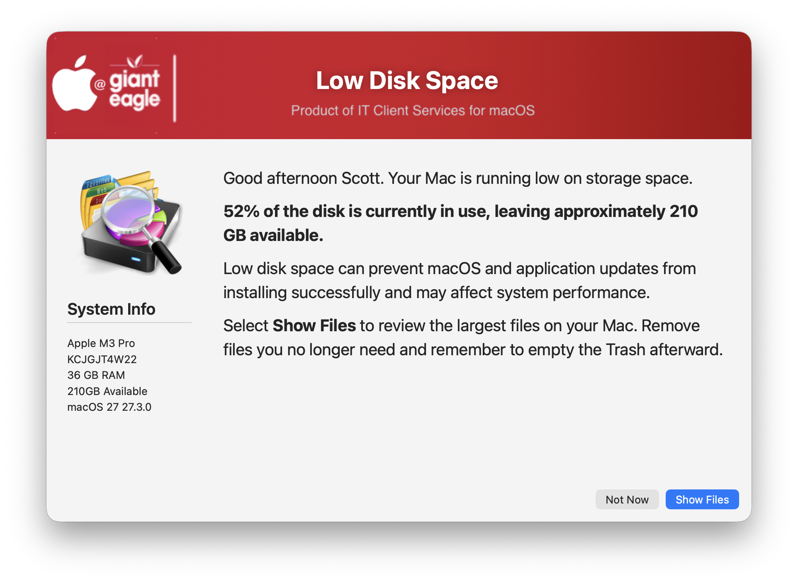
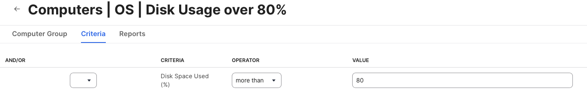

## Low Disk Space

Nice GUI alerting the user that their available disk space is below a certain threshold



An example of the smartgroup that can be setup for available disk space over 80%



and the Extended Attribute that creates the 'Disk Space Used %' field of each computer

```
#!/bin/zsh --no-rcs
DATA_VOLUME="/System/Volumes/Data"
result=$(/bin/df -P "${DATA_VOLUME}" | /usr/bin/awk 'END {gsub(/%/, "", $5)
    print $5}')

[[ -z "${result}" ]] && result="Unknown"
echo "<result>$result</result>"
```

**History**

| **Version**|**Notes**|
|:--------:|-----|
| 1.0 | Initial
| 1.1 | Code cleanup to be more consistent with all apps
| 1.2 | Remove the MAC_HADWARE_CLASS item as it was misspelled and not used anymore...
| 1.3 | Code cleanup
||       Added feature to read in defaults file
||       Fixed Show Files option to call correct trigger
||       removed unnecessary variables.
||       Fixed typos
| 1.4 | Fixed window layout for Tahoe & SD v3.0
| 1.5 | Changed JAMF 'policy -trigger' to JAMF 'policy -event'
||       Optimized "Common" section for better performance
||       Fixed variable names in the defaults file section
| 2.0 | Updated SD Version requirements to 3.1.0
||       Added ability to set subtitle, color, and padding from defaults file
| 2.1 | Updated disk usage calculation to use the APFS Data volume
||       Added available disk space to the user notification
||       Updated dialog messaging and button layout
||       Added "Not Now" option and made "Show Files" the primary action
||       Improved Jamf policy execution and error handling
||       Added root and SwiftDialog prerequisite validation
||       Improved logging and general code cleanup

