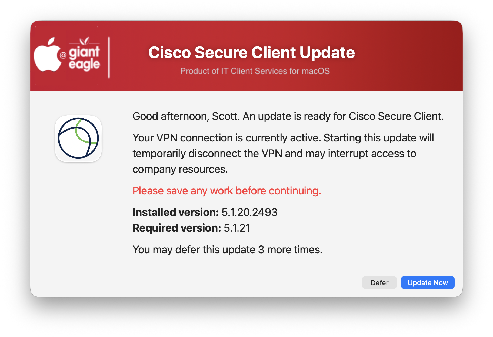

# VPN Upgrade Dialog

`VPNUpgradeDialog.sh` is a macOS remediation workflow for Jamf Pro that manages upgrades of an installed VPN client while protecting users from unexpected VPN interruptions.

The script determines whether the configured VPN client requires an upgrade, checks whether the VPN is actively connected, and uses SwiftDialog to notify the logged-in user before an upgrade interrupts their connection.

Although the example configuration uses **Cisco Secure Client**, the script is designed to be adapted to other VPN clients by changing a small set of configuration values.

## Features

- Compares the installed VPN client version against a required version supplied by Jamf Pro
- Skips the workflow when the installed version already meets or exceeds the required version
- Detects whether the VPN is actively connected
- Allows upgrades to proceed without user interaction when the VPN is disconnected
- Uses SwiftDialog to warn users when an active VPN connection will be interrupted
- Provides configurable user deferrals
- Persists deferral state between Jamf policy executions
- Automatically resets deferrals when the target VPN version changes
- Runs the VPN installation or upgrade through a configurable Jamf Pro custom event
- Validates the installed version after the Jamf policy finishes
- Runs Jamf inventory after a successful upgrade
- Uses the configured VPN application's icon automatically
- Derives the application name and dialog title from the configured `.app`
- Maintains independent preference and deferral data for each configured VPN application
- Logs workflow activity and failures for troubleshooting

## How It Works

1. Validate the required VPN version.
2. Determine the currently installed VPN client version.
3. Exit if the installed version already meets or exceeds the required version.
4. Check for an active user deferral.
5. Determine the VPN connection state.
6. If the VPN is disconnected, run the upgrade without displaying a dialog.
7. If the VPN is connected, display a SwiftDialog notification to the logged-in user.
8. Allow the user to update immediately or defer, if deferrals remain.
9. Run the configured Jamf Pro custom event.
10. Verify that the installed VPN version now meets the required version.
11. Clear active deferrals.
12. Submit updated Jamf inventory.

## Requirements

The script expects:

- SwiftDialog when user interaction is required
- A Jamf Pro policy with a custom event that installs or upgrades the VPN client
- A VPN application whose installed version can be determined by `get_vpn_client_version()`
- A command-line utility capable of reporting the VPN connection state

SwiftDialog is only required when the VPN is connected and user interaction is necessary. The script can use a Jamf custom event to install or update SwiftDialog when required.

## VPN Client Configuration

Before deploying the script, modify the VPN-specific configuration near the beginning of the script.

The Cisco Secure Client example is:

```zsh
VPN_CLIENT_APP="/Applications/Cisco/Cisco Secure Client.app"
VPN_CLIENT_BINARY="/opt/cisco/secureclient/bin/vpn"
VPN_CONNECTED_PATTERN="Connection State:            Connected"
```

### `VPN_CLIENT_APP`

Full path to the VPN client application.

Example:

```zsh
VPN_CLIENT_APP="/Applications/Cisco/Cisco Secure Client.app"
```

The application name is automatically derived from the application path:

```zsh
VPN_CLIENT_NAME="${VPN_CLIENT_APP:t:r}"
```

For the example above, the resulting name is:

```text
Cisco Secure Client
```

The derived name is used for the dialog title, messages, logging, and VPN-specific preference domain. The configured application is also used as the SwiftDialog icon.

### `VPN_CLIENT_BINARY`

Full path to the VPN client's command-line utility.

For Cisco Secure Client:

```zsh
VPN_CLIENT_BINARY="/opt/cisco/secureclient/bin/vpn"
```

The current connection-state function calls the binary using the `stats` argument. If another VPN client uses a different command to retrieve connection status, update `get_vpn_connection_state()` accordingly.

### `VPN_CONNECTED_PATTERN`

Text returned by the VPN CLI that identifies an active VPN connection.

For Cisco Secure Client:

```zsh
VPN_CONNECTED_PATTERN="Connection State:            Connected"
```

Before deploying another VPN client, manually run its CLI status command and determine which output reliably represents an active connection.

The script deliberately distinguishes a disconnected VPN from a failure to determine the VPN state. If the CLI is missing or the status command fails, the upgrade stops rather than assuming that it is safe to interrupt the VPN.

## Version Detection

The installed VPN client version is retrieved by:

```zsh
get_vpn_client_version()
```

The current implementation reads `CFBundleShortVersionString` from the application's `Info.plist`.

If your VPN application stores its version somewhere else, modify this function before deployment.

For example:

```zsh
/usr/libexec/PlistBuddy \
    -c "Print :CFBundleShortVersionString" \
    "${VPN_CLIENT_APP}/Contents/Info.plist"
```

## Jamf Pro Parameters

Configure the script in a Jamf Pro policy using the following parameters:

| Parameter | Purpose | Default |
| --- | --- | --- |
| 4 | Jamf custom event that installs or upgrades the VPN client | `updateVPN` |
| 5 | Maximum number of user deferrals | `3` |
| 6 | Deferral duration in seconds | `900` |
| 7 | Required VPN client version | Required |

The script uses:

```zsh
JAMF_TRIGGER="${4:-updateVPN}"
MAX_DEFERRALS="${5:-3}"
DEFER_SECONDS="${6:-900}"
VPN_VERSION="${7:-}"
```

### Example

For a target VPN version of `5.1.12.113`:

```text
Parameter 4: updateVPN
Parameter 5: 3
Parameter 6: 900
Parameter 7: 5.1.12.113
```

This configuration gives the user up to three deferrals, each lasting 15 minutes.

> Parameter 7 is required. The script stops if a target VPN version is not provided.

## Jamf Pro Installation Policy

The script does not directly install the VPN package. Instead, it calls a separate Jamf Pro policy using the custom event supplied in Parameter 4:

```zsh
/usr/local/bin/jamf policy \
    -event "$JAMF_TRIGGER" \
    -forceNoRecon
```

For example, if Parameter 4 is:

```text
updateVPN
```

create a Jamf Pro policy containing the appropriate VPN installer and configure its custom trigger as:

```text
updateVPN
```

This separation allows `VPNUpgradeDialog.sh` to control notification, deferrals, connection safety, and validation while the installation policy controls the actual VPN deployment.

### Post-install validation

A successful Jamf policy execution alone is not considered a successful VPN upgrade.

After the policy finishes, the script retrieves the installed VPN client version again and confirms that it meets or exceeds the version supplied in Parameter 7.

If the resulting version does not meet the requirement, the workflow is reported as failed and the deferral state is not cleared.

## User Experience

### VPN disconnected

If the VPN client requires an upgrade but the VPN is not connected, the script proceeds directly with the Jamf installation policy.

No SwiftDialog notification is necessary because there is no active VPN connection to interrupt.

### VPN connected

If the VPN is actively connected, the logged-in user receives a SwiftDialog message showing:

- VPN application name
- Installed version
- Required version
- A warning that the VPN connection will be temporarily interrupted
- **Update Now** button
- **Defer** button when deferrals remain

The application icon is automatically obtained from `VPN_CLIENT_APP`.

### No logged-in user

If the VPN is connected but there is no interactive user available to notify, the upgrade is postponed until a future policy execution rather than interrupting an active VPN connection without warning.

## Deferrals

Deferral information is stored in a VPN-specific preference domain derived from the application name.

For Cisco Secure Client, the preference domain is similar to:

```text
com.gianteagle.vpn-upgrade.cisco-secure-client
```

The script stores:

```text
DeferralCount
NextAllowedRun
TargetVersion
```



### Target-version awareness

Deferrals are associated with the target VPN version.

If the required version changes, for example:

```text
5.1.11 -> 5.1.12
```

previous deferral count and timing information are reset for the new version.

This prevents deferrals from an older deployment from incorrectly affecting a newer VPN update.

## SwiftDialog

SwiftDialog is used only when user notification is required.

The script currently requires SwiftDialog `3.1.0` or newer.

If SwiftDialog is missing or below the minimum required version, the script can invoke a Jamf Pro policy using the configured custom event:

```zsh
DIALOG_INSTALL_POLICY="install_SwiftDialog"
```

Configure a corresponding Jamf Pro policy if you intend to use automatic SwiftDialog installation.

## Logging / Reporting


The log records events such as:

- Installed and required VPN versions
- VPN connection status
- User deferrals
- SwiftDialog installation or validation
- User selections
- Jamf installation policy results
- Post-install version validation
- Jamf inventory submission failures

## Adapting the Script for Another VPN Client

At minimum, update:

```zsh
VPN_CLIENT_APP="/Applications/Your VPN.app"
VPN_CLIENT_BINARY="/path/to/your/vpn-cli"
VPN_CONNECTED_PATTERN="text indicating connected"
```

Then verify the following.

### 1. Version detection

Confirm that:

```zsh
get_vpn_client_version()
```

returns the correct installed version for the VPN client.

### 2. VPN status command

Confirm that the command used by:

```zsh
get_vpn_connection_state()
```

is appropriate for the VPN CLI.

The current implementation uses the `stats` argument. Modify the function if the VPN product uses a different command.

### 3. Connected-state output

Configure:

```zsh
VPN_CONNECTED_PATTERN
```

with text that reliably identifies an active VPN session.

### 4. Jamf installation event

Create the Jamf Pro policy responsible for installing or updating the VPN client and configure Parameter 4 with its custom event.

### 5. Required version

Set Jamf Parameter 7 to the version you want to enforce.

## Recommended Testing

Before production deployment, test at least the following scenarios:

1. Installed version already meets the requirement.
2. VPN client is outdated and disconnected.
3. VPN client is outdated and connected.
4. User selects **Update Now**.
5. User selects **Defer**.
6. User closes the notification window.
7. All deferrals have been exhausted.
8. A previously recorded deferral is still active.
9. The target version changes while old deferrals exist.
10. VPN CLI is missing.
11. VPN status command fails.
12. No interactive user is logged in while VPN is connected.
13. Jamf installation policy fails.
14. Jamf installation policy reports success but does not install the required version.
15. Upgrade succeeds but Jamf inventory submission fails.

## Safety Behavior

The script intentionally favors protecting an active user VPN connection.

It does not assume that the VPN is disconnected merely because its connection status cannot be determined.

If the configured VPN CLI is missing or its status command fails, the workflow stops instead of proceeding with an upgrade that might unexpectedly disconnect the user.

| **Version**|**Notes**|
|:--------:|-----|
| 1.0 | Initial production release
||       Added configurable VPN client, CLI, version, and connection-state detection
||       Added SwiftDialog notification for upgrades that interrupt an active VPN connection
||       Added configurable user deferrals with target-version tracking
||       Added Jamf Pro custom event support for VPN installation and upgrades
||       Added post-install version validation and Jamf inventory submission
||       Added automatic VPN application name, dialog title, and icon detection
||       Added per-VPN preference storage and deferral management
||       Added SwiftDialog installation, branding, logging, and error handling